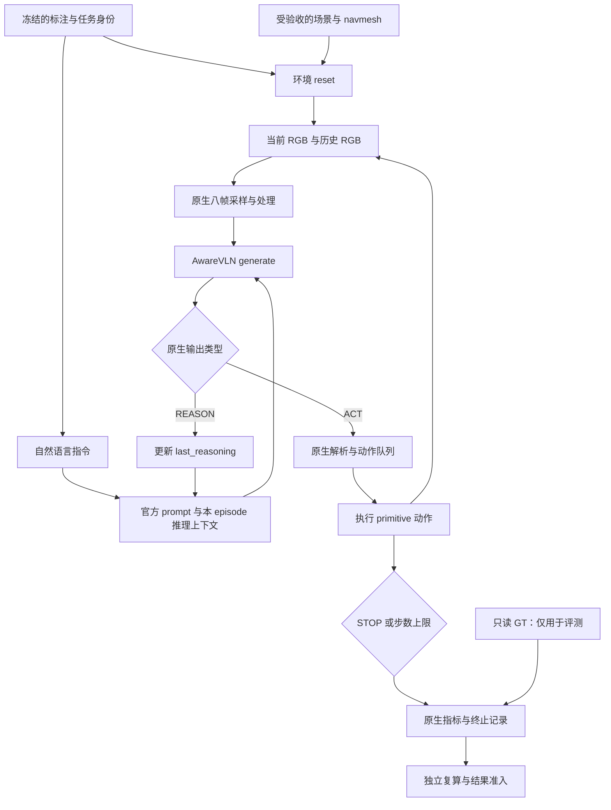

# AwareVLN 的逻辑链与数据流

本文件解释本部署的代码职责和运行接口。实际验证状态、失败与修正见本阶段 conclusion；图中的连线不是完成回执。

## 模块职责

| 层 | 实际入口 | 输入与输出 |
|---|---|---|
| 冻结与调度 | `scripts/evaluate.py` | 冻结源码、环境、资产、任务身份；将原始顺序划为八个逻辑分片，派发到空闲 GPU |
| 原生配置与模型入口 | `scripts/evaluate_worker.py` | 使用跟踪的 `src/`，配置只读权重与场景视图，调用原生 trainer |
| 任务加载 | `src/habitat_extensions/task.py` | 从完整原始标注分片，再按语言与显式任务清单过滤 |
| 环境 | `src/vlnce_baselines/common/environments.py` 与独立 Habitat | 从原始场景和选定网格生成观测、执行 primitive 动作、提供评测侧状态 |
| 导航策略 | `src/vlnce_baselines/awarevln_trainer.py` | 采样图像、构造官方 prompt、生成推理或动作、维护动作队列 |
| 模型 | `src/llava/` 与官方 checkpoint | checkpoint 自带视觉处理器、视觉塔、投影器和 Llama 模型完成生成 |
| 事实记录 | `src/case1_runtime/trace.py` | 在模型调用前记录输入，在调用后绑定输出，逐动作保存轨迹及原子结果 |
| 独立审计 | `scripts/recompute_metrics.py`、`scripts/audit_model_trace.py` | 从轨迹重算指标，重放输出解析并核对实际动作 |
| 正式登记 | `scripts/register_results.py`、`scripts/render_results.py` | 仅将验收通过的机器记录写入统一索引与 Markdown |

## 一次 episode 如何执行

原生采样保留当前帧，并从历史序列选择其余帧；不足时使用原实现的黑帧填充。模型使用 checkpoint 的图像处理器。不能用“保存了某张 RGB”代替“实际送入了模型”：记录器另存输入 token IDs、实际图像引用、处理后张量形状和生成前的张量哈希。

REASON 分支更新当前 episode 的推理文本，不执行环境动作。ACT 分支沿用原解析及动作展开。原实现连续产生四次 reasoning 后，下一轮会强制 STOP；记录中将此原因与模型直接输出 STOP 分开。未识别动作仍按原生 fallback 执行，并单独计数，不自动改写模型答案。

动作队列中的每个 primitive 都进入轨迹。官方配置的前进步长为 0.25m、转角为 15°、episode 上限为 500 个环境步骤，生成上限为 256 tokens。实际值以 worker 的最终配置和模型调用记录为准。

## episode 边界与可见信息

新的 episode 清理动作队列、图像历史、推理文本、计数器和相关缓存，并重置固定种子。初始 episode 也在模型加载后设置同样的随机状态。真实顺序复验必须比较同一 GPU 上“B 在 A 之后”和“B 单独运行”，不能拿两个都处于首位的任务冒充顺序测试。

模型输入仅包含原生指令、RGB 图像和模型自己产生的推理上下文。目标坐标、GT 轨迹、网格、测地距离、评测侧真值位姿不进入模型输入。评测侧状态单独标记 `*_evaluator_only`，用于核验，不作为动作选择依据。网格与 GT 可以用于明确标注的 Oracle 运动诊断，该诊断不计入模型成绩。

本次使用已有官方权重推理；评测入口不执行优化器更新或反向传播。既有模型的训练来源与本次运行证据分别记录。

## 记录、恢复和验证

`model_input` 在生成前落盘，失败的调用也能追溯输入。`model_call` 绑定实际输出 tokens 与文本；审计重新解码 token IDs，核对输入配对、图片像素、原生解析和动作队列。记录一致性不自动证明导航语义正确。

`launch-config.yaml` 记录启动参数；`effective-config.yaml` 在 trainer 完成 split、语言、分片和输出目录覆写后保存。正式结果引用后者，并通过 `effective-configs.json` 绑定整个 run 的实际配置集合。

每个结束的 episode 原子提交 `result.json`。控制器仅合并已提交记录，拒绝重复。恢复前检查运行锁与存活 worker；如果轨迹已经完整结束但提交被中断，先恢复该结果，避免重复推理或择优重跑。单纯的文件存在、接口返回或 CPU 测试通过均不等于正式导航验收。
