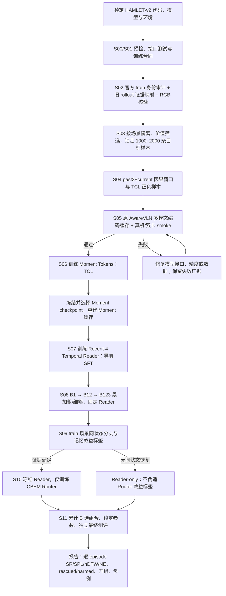
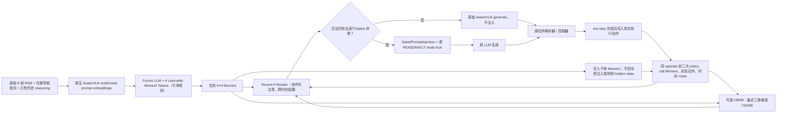

# HAMLET-v2：R2R / RxR-en-US 小样本记忆训练、Checkpoint 选择与导航验收技术手册

> **文档用途**：供 Codex 和实际训练执行者依序执行的工程主手册。它定义已实现代码的使用方式、需要服务器补齐的真实数据、各阶段输入/输出、验收与回退条件，而不是新的模型实验结果。
>
> **仓库**：[woaijieyang/test — HAMLET-v2](https://github.com/woaijieyang/test/tree/HAMLET-v2)  
> **已核验代码提交**：[`56220f393f1342bfbb55b76faa39e6f76fda1cac`](https://github.com/woaijieyang/test/commit/56220f393f1342bfbb55b76faa39e6f76fda1cac)  
> **已核验 GitHub Actions**：[45143177446](https://github.com/woaijieyang/test/actions/runs/45143177446)：101 项 CPU 测试通过；两进程 Gloo 合成训练检查通过（4 optimizer steps）。这**不代表真实 AwareVLN 8B、两张 A6000、Habitat、训练结果或 SR 已验证**。  
> **资源**：2 × RTX A6000（48 GB/卡），正式训练需在实际服务器重新做显存、梯度和精度 smoke。  
> **唯一训练数据白名单**：R2R `train`、RxR Guide `train` 中严格的 `en-US`；候选目标 1,000–2,000 条路线—指令样本，默认选择总量 1,500（包含内部 memory-dev）。  
> **版本与权限边界**：保留原 8 帧视觉、完整指令、REASON/ACT token、动作解析和评估协议；不修改 poseAdapter、graphAdapter；所有新路径 opt-in，原 baseline / `hamlet` 仍须可使用。

---

## 一、先明确“完成”的含义、冻结的实验合同与总 workflow

本项目已经拥有 **CPU 训练代码链与可用的 GitHub 提交**，尚不具备“训练效果经过验证”的证据。正式完成应同时具备：数据来源合法；必要训练样本数量与能力漏斗可复核；Moment/Reader/Router 各自产生有父级身份绑定的 checkpoint；模型在真实 AwareVLN 下具有正确可微梯度与推理功能；开发集按 B1 → B1∪B2 → B1∪B2∪B3 累计选择；最终模型在独立评测上能提供原始 episode 指标和配对差异，而不是只有 SFT loss。

本手册的**唯一主线**是 S00→S01→S02→S03→S04→S05→S06→S07→S08→S09→S10→S11。任何阶段未通过，不自动跳到下一训练阶段。S09 若因缺失可证实的同状态恢复能力而阻塞，允许保留已验证的 Reader-only 模型并转到 S11 做固定 Reader 的候选评估，但不得将未训练的 Router 宣称为有效。每阶段都必须写入 `PASSED`、`FAILED` 或 `BLOCKED` 状态，以及真实证据路径、失败原因和回退步骤。

### 1.1 从数据到模型的唯一流程



### 1.2 在线数据流与严格时序



`recent-4` 在实际实现中是过去**三个 policy-call** 与当前 call，总共四个时刻、每时刻四个 Moment Tokens。它**不是**过去四帧，也不保证等价于四个 primitive 动作。缺失的 call 使用 `None` 与 mask 保持时间孔洞，不允许把旧 call 挤进最近位置；模型刚提出但环境尚未执行的动作不能记为 `executed`。CBEM 只对合法的过去三个候选做选择，不启用历史 `archive-256` 的全量检索。

### 1.3 不得变更的接口和指标

导航输入继续使用原 AwareVLN 的八帧、指令与此前 reasoning；模式 token 为 `<BEGIN_OF_REASONING>` 和 `<BEGIN_OF_ACTION>`，`mode_lock=true`；执行动作空间、终止判据、最大步数、Habitat 评估配置及路径归一化全部保持原来的冻结协议。`hamlet-trained` 是新候选的独立 opt-in，旧 `baseline` 和 `hamlet` 不应因新增训练文件被改变。评估核心为 SR、SPL、nDTW、NE，同时保存实际干预次数、NONE/USE、Reader gate 与 alpha、rescued/harmed、推理时延与显存。任何非零指标提升都须与同 episode、同协议 baseline 配对，禁止只挑成功案例。

---

## 二、真实文件组织与数据根目录合同

### 2.1 已提交代码中使用的增量目录（非虚构拟议结构）

```text
HAMLET-v2/
├── .github/workflows/hamlet-cpu.yml
├── configs/hamlet/
│   ├── aw4-seed10.json                         # 历史 HAMLET 配置，保持原功能
│   ├── source-provenance.json
│   └── training/
│       ├── plan.yaml                           # TCL / Reader / Router 默认训练预算
│       └── evaluation.yaml                     # 累计 B 模型筛选条件
├── docs/hamlet/
│   └── HAMLET-v2_实施与训练执行手册.md
├── scripts/
│   ├── with_runtime.sh                         # 原服务器隔离运行时
│   ├── evaluate.py                             # baseline / hamlet / hamlet-trained 评估
│   └── hamlet/
│       ├── run.sh                              # 统一审计/训练 CLI wrapper
│       └── test_cpu.sh                         # 原 HAMLET + 新训练测试
├── src/
│   ├── awarevln_memory/
│   │   ├── memory/adapter.py                   # 原 GatedPromptInjection + target mask
│   │   ├── memory/state.py                     # 旧状态结构保持
│   │   ├── cbem/router.py                      # 复用已有 CBEM scorer/NONE
│   │   └── training/
│   │       ├── artifacts.py                    # SHA、写入、split 隔离、预算
│   │       ├── bootstrap.py                    # 原生模型身份与初始化
│   │       ├── data.py                         # 官方 train 导入、价值选取、窗口
│   │       ├── rollouts.py                     # 旧 rollout 字段映射及身份核验
│   │       ├── observations.py                 # 真实 RGB 可读性/来源检查
│   │       ├── datasets.py                     # TCL/Reader/Router Dataset
│   │       ├── preprocess.py                   # 原 AwareVLN 图文预处理
│   │       ├── cache.py                        # 不可变 safetensors 与 read-set 指纹
│   │       ├── masks.py                        # 同时刻块内、跨时刻因果 Mask
│   │       ├── models.py                       # Moment / Reader / StageModel / CBEM 损失
│   │       ├── engine.py                       # Accelerate + AdamW + checkpoint/resume
│   │       ├── checkpoints.py                  # 小型权重/父级身份/部署 bundle
│   │       ├── counterfactual.py               # 反事实证据验证，不实现环境模拟
│   │       ├── evaluation.py                   # 累计 B 与候选选择
│   │       ├── runner.py                       # stage dry-run、身份与 smoke gate
│   │       └── pipeline.py                     # 真正存在的 CLI 子命令
│   ├── hamlet_v2/
│   │   ├── policy.py                           # 原/新候选的 worker 身份隔离
│   │   └── trained_runtime.py                  # 原始生成回退与 RecentState
│   ├── llava/train/train_hamlet.py             # 薄入口，不重写 LLaVA Trainer
│   └── vlnce_baselines/awarevln_trainer.py     # opt-in 记忆推理接入与 env.step 回执
└── tests/
    ├── hamlet/                               # 原测试，不允许删除/跳过
    └── hamlet_training/                      # 新训练、数据、身份、梯度与恢复测试
```

训练代码在仓库已有目录上增量建设，不创建另一套与原导航代码互不兼容的网络。请勿把原主干 `llava/train/train.py` 全局重构；当前真实训练引擎是 **Accelerate 0.27.2 + PyTorch**，不是此前设计稿中提到的独立 Hugging Face Trainer。它用 `accelerator.prepare()`、`accelerator.accumulate()`、`accelerator.backward()` 管理设备和梯度累积，使用现有的 AdamW 与 cosine 学习率衰减；不新增 DPO、PPO 或其他尚未验证的算法。原 `with_runtime.sh` 和当前服务器 Landlock/运行时保护规则继续适用。

### 2.2 服务器数据目录：训练和 val-unseen 必须硬隔离

**评估目录由用户确认且不可改名：**

```text
/data/zy/vln/data/checkpoint-choice/
└── VLN-awareVLN/
    └── B/
        ├── r2r/                               # 全部属于 val-unseen
        │   └── <原样保留服务器中 B1/B2/B3 实际文件名>
        └── rxr_us/                            # 全部属于 val-unseen
            └── <原样保留服务器中 B1/B2/B3 实际文件名>
```

`<...>` 仅为目录树说明，**不是**实际存在的文件名；执行前由 Codex 用 `find`/`ls` 和 JSON 检查定位。A 和 Remaining 目录的身份必须读取真实目录/manifest 确认，不能根据名称假定独立或未见。`training_path()` 对 `/data/zy/vln/data/checkpoint-choice/` 实施强拒绝；训练 Dataset、TCL negative pool、特征缓存拟合和 CBEM 分支生成均不得读取这个根目录。

训练数据位置不能凭空指定。本手册使用必须由服务器真实发现并锁定的三个变量：`R2R_TRAIN`（官方 R2R train 标注）、`RXR_US_TRAIN`（RxR 训练中的 en-US 连续版/指南标注）、`RXR_GUIDE_TRAIN`（如果连续数据缺语言字段，则必须提供官方 RxR Guide train）。所有文件需保存绝对路径、大小、SHA256、split 证明与原始来源，不得将评估 JSON 复制到别处伪装成 train。空间位置、reference path、GT 进度等仅作为**训练期的样本构造和负例过滤辅助**，不得进入部署模型 Query/Reader/Router 的在线输入。

### 2.3 运行产物目录和不可覆盖原则

每次正式尝试使用新的运行根目录（例如 `outputs/hamlet-train-20261123-a`，实际需检查不存在）：

```text
${RUN_ROOT}/
├── contracts/
│   ├── base_inventory.json                     # 原生基础模型真实权重文件指纹
│   ├── protocol.json                           # 8帧/模式token/源码/FP16合同
│   ├── paths.lock.json                         # 初始化状态与目录身份
│   └── {tcl,reader,router}-smoke.json           # 仅真实验证后写入
├── configs/{tcl,reader,router}.yaml             # init 自动生成，运行前明确审查
├── manifests/
│   ├── r2r-audit/、rxr-audit/
│   └── selected/                                # selected, train, memory-dev, lock
├── observations/                                # 旧 rollout、RGB 检查、修复队列
├── datasets/raw/                                # TCL、windows、事件、排除漏斗
├── datasets/{tcl,reader,router}.accepted.jsonl  # StageDataset 的最终白名单
├── cache/{prompts,moments,router}/              # 不可变 safetensors + metadata
├── checkpoints/{tcl,reader,router}/             # 各阶段小型权重与精确 resume
├── selected/{moment,reader}/                    # 固定的父阶段 checkpoint
├── eval/{r2r,rxr}/                             # B1/B12/B123 与原始评估证据
├── release/                                     # opt-in inference bundle
└── reports/                                     # 训练/筛选/评估/失败报告
```

`init` 只自动创建 `contracts/` 与 `configs/` 等实际写入位置；上述其他目录有些将在后续命令独占创建，**不要认为初始化立即建好了所有文件**。所有命令应使用不同、尚不存在的 `--output` 路径，原有产物不得删除覆盖。缓存是不可变内容寻址的 safetensors，单文件写入采用 fail-if-exists 与校验，跨文件缓存写入不是数据库式完全事务；失败时应保留审计记录并通过新 run 重新生成，不通过关闭校验强行继续。

---

## 三、S00：锁定 Git、基础模型、服务器资产与协议

**进入条件**：Git 分支为 `HAMLET-v2`；已同步提交 `56220f393f1342bfbb55b76faa39e6f76fda1cac`，或更高版本但经过重新差异审计；可读取原有原生模型预检文件。该阶段只做工作区读取和产生本次新运行合同，不启动训练、不改权重、不改导航控制。Codex 首先执行 `git status --short`、`git rev-parse HEAD`、`git branch --show-current`，记录是否存在其他人未提交改动；若工作树并行变化，停止受影响修改并保留用户工作。

基础模型身份来源必须是项目现有 `outputs/preflight/model.json` 中的真实模型文件列表与 SHA，以及 `models/awarevln/llm/config.json`。`bootstrap.initialize()` 会检查所有文件是否存在、SHA 是否与预检一致、LLM hidden_size 是否可读取，并将训练相关源码文件的 hash 写入 `protocol.json`。不从 HF 在线下载一个“看起来一样”的模型来绕过本地权重缺失。当前代码固定 `visual_frames=8`、`temporal_total_slots=4`、`history_past_calls=3`、`moment_tokens_per_slot=4`、`mode_lock=true`、`clean_encoding_dtype=float16`；如实际模型不是 FP16，应在进入后续缓存前阻塞并重新定义经验证的协议，而不是让缓存自动投射成另一种精度。

真实命令：

```bash
cd /data/zy/vln/case2  # 仅示例：必须先以实际有权限的工作区为准
export WORKSPACE="$PWD"
export RUN_ROOT="$WORKSPACE/outputs/hamlet-train-20261123-a"

git status --short
git branch --show-current
git rev-parse HEAD
bash scripts/hamlet/run.sh init --workspace "$WORKSPACE" --output "$RUN_ROOT"
```

**输出**：`contracts/base_inventory.json`、`contracts/protocol.json`、`contracts/paths.lock.json` 与三份 YAML。初始化的 `status=PATHS_MATERIALIZED_NOT_TRAINING_READY` 不是训练可启动许可证。需手动读取 plan 和协议，确认模型来源、八帧采样与 token 名称无漂移，列出所有 B 分片目录但不从中生成训练样本。A/Remaining 的正式角色尚不明确时明确标记 `UNKNOWN`，不能用作训练或推断测试集。

**验收与回退**：检查源文件 hash、有效隐藏维度、原生模型配置、三份 YAML 中的所有真实路径；输出目录必须是本次独占新目录，失败时不产生误导性“训练完成”标记。若基础模型预检不存在或 hash 不符，返回既有官方 preflight 流程修复；若 Git 版本改变，则重新进行代码差异/协议审查；严禁手动把 `paths.lock.json` 改成 PASSED。只有基础资源全部可追溯，才进入 S01。

## 四、S01：训练代码、数据 API 与 CPU 回归验收

**进入条件**：S00 合同已生成，且目标分支中的训练模块存在。Codex 不需要重新设计一套新的 `Trainer`，只检查 `src/awarevln_memory/training/{models,engine,runner,pipeline}.py` 与当前 AwareVLN/Runtime 的接口是否匹配：训练 Moment 编码必须保留 prompt/target 区分、Reader 必须按因果序列读取、Router 的排序 loss 不能通过离散选择传播错误梯度；旧 `baseline`/`hamlet` 不受新的 `hamlet-trained` 参数影响。

CPU 测试执行：

```bash
bash scripts/hamlet/test_cpu.sh
PYTHONPATH=src OMP_NUM_THREADS=1 MKL_NUM_THREADS=1 \
python -m torch.distributed.run --standalone --nproc_per_node=2 \
  tests/hamlet_training/distributed_probe.py \
  --output /tmp/hamlet-cpu-ddp-unique-run
```

覆盖范围应包含：目标答案后缀不可见、未来时刻不可读取、相同时刻四 Token 保留、padding 不产生 NaN、episode reset、无记忆输出等价、合法梯度到 Moment/Reader、冻结 backbone 梯度为空、CBEM NONE 的实际比较逻辑、checkpoint 恢复与缓存身份、train/val-unseen 隔离、失败后的产物清理。GitHub 远端提交 `56220f...` 的 CI 已记录 101 项 CPU 测试通过，双进程合成检查也通过；在用户服务器上仍需执行同一套回归，以排除本地环境、依赖差异和原有安装问题。过去某次 CI 失败不能作为本提交的当前失败，反之 CPU 成功也不是 GPU 通过。

参数更新与训练算法此阶段均为零；本阶段应生成 `reports/s01_cpu_contract.json`，写入测试命令、exit code、环境摘要、完整日志路径及与仓库 SHA 的绑定。不能只保存“101 passed”一句话，也不能跳过旧测试以得到绿灯。对导入依赖造成的测试收集失败，修复可选模块的导入边界和官方依赖环境，不能删除对应测试文件。

**验收与回退**：全部已有和新增 CPU 回归成功；合成 DDP 的步数与 RNG 恢复测试成功；源码没有超出范围的改动。失败则停在 S01，先诊断当前依赖和接口，再按最小改动修复后重测；不能进入 S02/S05 的正式资产编码。若只有轻量 CPU 环境只能运行子集，状态必须是 `PARTIAL/BLOCKED` 而不是 PASSED。

---
## 五、S02：官方训练数据、旧 rollout、RGB 与标签可用性审计

**进入条件**：S01 CPU 合同通过；已经在服务器上明确定位官方 R2R train、RxR Guide train（严格 en-US）和本机连续 VLN-CE 训练资源。训练数据只允许 `r2r/train` 与 `rxr/train/en-US`；原始 R2R 多条语言描述是同一条路线的不同指令，不应直接等于独立路线数；RxR 的 en-IN、hi-IN、te-IN 不参与本实验。官方 RxR Guide 记录使用 `split`、`instruction_id`、`language`、`path_id`、`scan`、`path`、`heading`、`instruction`、`timed_instruction` 字段；连续 CE 记录缺失 `language` 时必须使用权威 Guide 的唯一 instruction ID join 进行确认，不能根据 `rxr_us` 文件夹名或文本看起来像英文就判定为 en-US。见 [RxR 官方说明](https://github.com/google-research-datasets/RxR)。

**第一遍：原始标注审计**。`audit` 命令读取 JSON、JSONL、gzip JSONL 和合法 `episodes` 结构，生成 `candidates.jsonl`、`rejected.jsonl`、`data_funnel.json`。`ingest()` 会检查输入源是否明确属于 train：原始记录有 `split` 时必须 `train`；没有逐行 split 时源文件名必须具有明确的 train 身份，并由执行者另行保存官方文件来源佐证。它还拒绝明确包含 val/test 标识的输入路径。`language` 为非 `en-US` 的 RxR 被排除；缺 `instruction_id` 的 R2R 可以使用原始 `path_id` 或明确标注的 CE episode 构造稳定局部身份，但必须保留真实原始字段，不能虚构 RxR instruction ID。

```bash
# 这些变量必须由实际目录审计填入，本手册不猜测具体文件名。
: "${R2R_TRAIN:?official R2R train annotation is required}"
: "${RXR_US_TRAIN:?official RxR en-US train or CE train is required}"
: "${RXR_GUIDE_TRAIN:?official RxR Guide train required when CE lacks language}"

bash scripts/hamlet/run.sh audit --dataset r2r \
  --source "$R2R_TRAIN" --output "$RUN_ROOT/manifests/r2r-audit"

bash scripts/hamlet/run.sh audit --dataset rxr \
  --source "$RXR_US_TRAIN" --guide-source "$RXR_GUIDE_TRAIN" \
  --output "$RUN_ROOT/manifests/rxr-audit"
```

**第二遍：复用旧 rollout 但绝不改写 split**。先审阅旧日志每条记录的完整字段，尤其是 `task_key`、`split/source_split`、scene/episode/instruction 身份、`call_id`、prompt、实际观测帧路径和时间归属。项目历史 `src/case1_runtime/trace.py` 把任务身份固定为 `val_unseen`；这些轨迹即使恰好同场景、同 ID 也不能通过更名改造成 train。新的 `extract-rollout` 需要真实 `source_split=train`、`split=train` 或 native `task_key` 中的 `|train|` 段；它还核对原生 `instruction_id` / `episode_id` 是否与官方 train route 匹配，避免同场景但不同任务的错误拼接。只匹配某条 train route，**不能独立证明这次观察的来源也是 train**。

`extract-rollout` 的映射配置采用点路径 `mapping.fields`；必须包含 `event_id`、`rollout_id`、`call_id`、`prompt`、`image_paths`、`image_call_ids`、`protocol_identity`，以及真实 `route_key` 或由 scene 加 instruction/episode 组成的唯一 `route_join`。下面的 mapping 是**字段说明模板**，实际字段路径必须依据真实 trace 填写，绝不能把示例名强行套到不同的日志结构：

```json
{
  "fields": {
    "event_id": "<旧日志中真实的观察事件ID字段路径>",
    "rollout_id": "<真实的rollout ID字段路径>",
    "call_id": "<真实的policy call字段路径>",
    "prompt": "<完整原生8帧prompt字段路径>",
    "image_paths": "<逐图文件路径列表字段路径>",
    "image_call_ids": "<逐图观测时序索引字段路径>",
    "protocol_identity": "<旧观测捕获协议身份字段路径>"
  },
  "route_join": {
    "scene": "<旧日志中scene字段路径>",
    "instruction_id": "<旧日志中instruction_id字段路径>"
  }
}
```

模板中的尖括号表示**必须先由 Codex 用真实日志替换**，不是可直接运行的配置。若记录没有 protocol 身份、逐帧时间、train 来源证据或可唯一 join 的任务身份，应写入 `repair_queue.jsonl`；没有可信 target label 的事件可保留为观察候选，但不能冒充专家 ACT/REASON 监督。导入命令：

```bash
bash scripts/hamlet/run.sh extract-rollout \
  --source "$VERIFIED_TRAIN_ROLLOUT" \
  --routes "$RUN_ROOT/manifests/r2r-audit/candidates.jsonl" \
  --mapping "$VERIFIED_MAPPING_JSON" \
  --output "$RUN_ROOT/observations/r2r-import-01"
```

RxR 的 train rollout 使用其 `rxr-audit/candidates.jsonl` 另行处理；输出 `events.jsonl` 和 `repair_queue.jsonl`。多个来源合并前要验证 `event_id` 唯一，保留 `source_sha256`、source record index、原始 rollout checkpoint、捕获协议、实际 `executed_actions`。**只有环境 `env.step()` 后的动作才算执行过**；模型刚提出的动作必须保留为 proposed，不可提前写入历史。

**第三遍：图像与执行能力漏斗**。调用 `audit-observations` 对实际文件路径及解码能力进行检查；缺图片、损坏图片、未被保存的原八帧会按事件和槽位进入修复队列，而不是删除整条路线；但未经修复的样本不进入必须读取这些帧的阶段。对每条 route 分别统计 `observation`、`act`、`reason`、`replay`：有完整合法 RGB 不表示有专家动作；有可信专家动作不表示有真实 reasoning；没有完整环境快照不影响 SFT，却会阻止 S09 的强反事实标签。对 R2R/RxR 数据出现的“可用数据很少”，必须用以下漏斗报告定位根因：`raw → official_train → en-US → unique_identity → mapped_route → valid_frames → trusted_ACT → causal_windows → cache_accepted`。

```bash
# MERGED_TRAIN_EVENTS 是经过来源合并、审计、去重后真实存在的 JSONL。
bash scripts/hamlet/run.sh audit-observations \
  --events "$MERGED_TRAIN_EVENTS" \
  --output "$RUN_ROOT/observations/rgb-audit"
```

**验收与回退**：每个记录均有训练 split 证据和 dataset/语言/任务身份；每条拒绝记录都有原因码和可追溯来源。保留合法缺 reasoning / replay 的样本并报告其能力，不把测评 trace 回流训练。至少抽查每来源 50 条图像—指令—动作—时间对齐；若来源不明、原始文件缺失、动作映射不符合当前协议，回到 S02 修复读取器或在合法 train 环境补采，**不能**降低 split 或动作可信度门槛凑数量。该阶段不训练任何参数。

---

## 六、S03：精选 1,000–2,000 条高价值 route-instruction 与内部分区

**进入条件**：S02 输出官方 accepted route index 和通过 RGB 核验的 train 事件。首先在全部合法候选中按 `dataset × scene × route family × instruction` 建立身份；`route_key` 是 `dataset:scene:instruction_id`，同场景和有序路径构成 route-family hash。该 family 不是新的独立 GT 监督，而是去重/分组信息；同一路线的两条不同指令可以作为两个 route-instruction，但不能当成两个独立路线。R2R 与 RxR 同 Matterport 场景的数据必须按 scene 统一隔离，不能各自随机 train/dev 后产生跨数据源泄漏。

**真正运行的筛选算法**在 `data.select_routes()`，并非简单取最长或最复杂的 Top-1500。首先筛掉不具备可信 ACT 监督的路线（它们可留在原始观察资产/修复清单，但不自动进入本轮 SFT 主精选池），然后按训练场景分配约 10% scene 给 `memory-dev`，要求 train/dev 两侧都包含 R2R 和 RxR。所有同场景路线及其窗口不得跨越分区。若现有 scene 覆盖根本无法满足两侧都含两个数据集，函数报错；此时应扩大合法 train 场景或修复匹配，不靠划分同一路线前后窗口制造伪 dev。

六项价值分数严格以可复现代理计算，权重为：

\[
S=0.25L+0.20G+0.20T+0.15A+0.10V+0.10Q.
\]

`L` 是路线 reference path 的 edge 数分位，代码使中长程优先于极端长程；`G` 是固定房间/物体词典命中数加 temporal/order 连接词计数；`T` 是**已记录动作序列**中动作块切换数量；`A` 是已记录的左/右转向交替；`Q` 是 route 事件中同时具备合法 prompt 和 image_paths 的比例；`V` 仅当源资产真实提供 `visual_diversity` 才计入。缺 `V` 会记录 missing 并对其余已有权重重新归一化，不能伪造 0.5 或声明已运行视觉聚类。`L/G/T/A/V/Q` 都是筛选启发式，**不等于 Router 的真实记忆效益监督**。

在每个数据源和分区内部，代码按 `grounded 35% / turns 25% / confusable 20% / ordinary 20%` 进行分层、分家族和场景上限选择，先尝试每家族一条，再在出现合格数量缺口时放宽软约束；每家族最多两条。`confusable` 类目前包括路径重复 viewpoint 或极低视觉变化代理，不能声称自动检测了所有“相似房间”。`S_i` 与分类证据应写入 `selected.jsonl`，包含被放宽的 quota、缺少的特征及其归一化统计。首轮使用 1:1 配额：总量 1,500，则 R2R/RxR-en-US 各目标 750，**包括约 10% memory-dev**。如果实际 train route-instruction 少于 1,000，代码禁止正式训练；不许把 dev 转成 train 以满足数量。

```bash
bash scripts/hamlet/run.sh select \
  --routes "$RUN_ROOT/manifests/r2r-audit/candidates.jsonl" \
           "$RUN_ROOT/manifests/rxr-audit/candidates.jsonl" \
  --events "$RUN_ROOT/observations/rgb-audit/ready_events.jsonl" \
  --total 1500 --seed 42 \
  --output "$RUN_ROOT/manifests/selected"
```

**产物与检查**：`selected.jsonl`、`train_routes.jsonl`、`memory_dev_routes.jsonl`、`selected.lock.json`。输出应报告实际 train/dev 数量、scene/family/route-instruction 数量、各类分数与配额、R2R/RxR 比例、每种数据能力缺失及其原因。确认所选 route family 与 B 评测身份无交集；验证原始路线与不同指令之间的映射一致。每来源再次抽查至少 50 条，覆盖高评分样本、普通样本和边界样本，抽查地标与时间顺序。随机种子和数据 hash 固定后不再因为 B 的分数不好而调换训练路线。

**验收与回退**：正式集合总量为 1,000–2,000，实际用于优化的 train route-instruction ≥1,000，train/memory-dev scene 与 family 交集为零，R2R/RxR 两侧都有代表性；`selected.lock.json` 可复算。若筛选数量不足，按硬质量失败统计先修复 ID join、RGB、可信 ACT 来源或稀疏场景覆盖，再重新执行 S02/S03；绝不能引入 Landmark、en-IN 或 B 样本填满配额。此阶段仍不更新模型参数。

---

## 七、S04：严格因果窗口、TCL Triplet 和真实动作/Reasoning 监督

**进入条件**：S03 的 `selected.jsonl` 已固定，合法 train 事件具备连续 `call_id` 或明确的缺 call 情况。`windows` 依据 route + rollout ID 分组，首先按 `call_id` 排序，并验证 call 唯一且正整数；当前时刻记为 `t`，过去槽位固定 `t-3,t-2,t-1`，其间缺失的调用保持空槽，不会把更早、可读的记忆顺序前移。新样本仍携带原八帧图像 prompt（包含当前图像和按原基线采样的七张历史图像），Memory 则是额外的小型历史特征；不能把 `recent-4` 理解为取代原八帧输入。

**训练 ACT 的可靠性**必须由 `target_source∈{expert,verified_correction,verified_annotation}` 加 `target_provenance` 与真实 `target_text` 共同证明。对原策略失败 rollout，合法历史观察可以用于 Moment/TCL 或 Reader 的有标签子集，但失败动作本身不能默认作为专家行为克隆标签；教师纠正必须来自合法 train 的参考路线或已验证的纠正标注，并与当前执行环境动作协议一致。Reasoning 也只能使用真实存在的、模式兼容的标签，不能根据完整参考路径为当前时刻补写看似真实的未来计划。

**TCL 负样本构造**在 `datasets.tcl_triplets()` 中遵循两层策略：优先从同一 rollout 内寻找训练期可信三维位置距离 ≥2.0 米、且不同 viewpoint 的时刻作为空间已验证负样本，标记 `verified_spatial_same_rollout`；若同轨迹无法取得且允许后备，才在**相同 partition、相同 dataset、不同 scene 的官方 train 观察**中寻找负样本，标记 `cross_scene_train_fallback`。后者只是一种辅助“跨场景地点差异”信号，**并非原 HAMLET 的严格同轨迹时间对比学习**。没有确切位置不能猜测两米距离；没有合法负例则排除该 TCL pair 并保留 `NO_SPATIAL_OR_SCENE_DISJOINT_NEGATIVE` 原因。所有 positive 必须从 anchor 的当前图像轻量增强产生，文本和其余七张历史图像不变，增强不能改变路标身份或空间关系。

**执行命令**会同时输出带时间的 windows 和 TCL pairs，而不是训练时动态随意抽取：

```bash
bash scripts/hamlet/run.sh windows \
  --routes "$RUN_ROOT/manifests/selected/selected.jsonl" \
  --events "$RUN_ROOT/observations/rgb-audit/ready_events.jsonl" \
  --max-anchors 12 \
  --output "$RUN_ROOT/datasets/raw"
```

**实际输出**：`windows.jsonl`、`tcl.jsonl`、`events.jsonl`、`excluded_windows.jsonl`、`excluded_tcl.jsonl` 和 `dataset_bundle.json`。统计要求至少包括每种数据源与分区的独立 route-instruction、每条路线的窗口数、正负样本来源比例、平均有效历史槽位数、缺图、缺标签、mode 不兼容、停止标签分布。`--max-anchors 12` 是每 route 的候选窗口上限，不意味着每条路线一定产生 12 个可训练样本；一个路线产生多个窗口不能被当成多个独立路线。由于 RxR 路线通常更长，训练采样必须按数据源、route family 归一，避免窗口数天然放大 RxR 权重。

**验收与回退**：必须有可正常编码的 TCL positive/negative 对和包含 ACT 监督的 SFT 窗口；模型可见的数据严格局限于当前和以前。对 `prompt_contains_target`、完整 target 正文出现在 prompt 中、未来 `image_call_ids`、时间倒退、跨 scene/rollout 混记忆，必须拒绝而不是仅做日志提醒。若窗口大量因缺 target 或缺八帧排除，回 S02 补采或修原始记录解析；若只有 TCL 负样本不足，不应连带删除该路线的 Reader/SFT 合法窗口。此阶段不更新参数。

---
## 八、S05：原生图文预处理、特征缓存、真实 8B/GPU smoke 门槛

**进入条件**：S04 生成 `datasets/raw/events.jsonl`、`tcl.jsonl`、`windows.jsonl`，并在 S00 中锁定真实 AwareVLN 模型及 `protocol.json`。本阶段是训练前最重要的接口检验：当前代码只接受原生八帧、原始 Image Processor / tokenizer / 视觉投影器与已有 REASON/ACT conversation，不能用自写简化 tokenizer 或随机张量替代真实输入。`cache-prompts` 调用原模型的 `prepare_inputs_labels_for_multimodal()` 生成完整 prompt embeddings；缓存的输入特征只来自已观测 RGB 和历史 prompt，不包含当前 target 的 token embedding。单独保留可信 `target_ids` 供 Teacher Forcing 使用。损坏图像、错语言、mode 不兼容和 stop token 不明确都要记录原因，不能悄悄截断或补写标签。

**源观测与目标的两条路径必须分开**。模型 Query 使用 prompt embeddings 和相应 `prompt_mask`；`target_text` 仅在已核验 `target_source`、provenance 与原生模式 token 时进入 `target_ids`。`prepare_event()` 会检查 8 个 `<image>` 占位、8 个图像路径、`prompt_contains_target` 及完整答案直接包含在 prompt 中的泄漏；SFT mode token 必须与冻结 baseline 的首个模式决策一致，冲突样本保留为观察、拒绝作为该阶段 SFT 目标。没有合法 conversation 终止符时不人为创造 stop；不允许把来自旧模型的 hidden states 直接拼接到当前模型中，必须使用当前锁定模型从真实 RGB 重新编码。训练期会在缓存 metadata 中同时保存旧捕获协议身份与新编码协议身份，以便追溯。

**先建 prompt 缓存，再分别审核阶段数据**。下列命令确实存在。`cache-prompts` 从 TCL pair 和 Reader window 实际引用的事件集合中挑选需要的输入；不会无目的地对所有 rollout 图片编码。`--output` 指向之前不存在的新目录，失败时保留可复核原因。`cache-moments` 只能在 S06 选择 Moment checkpoint 后执行，不能提前运行。

```bash
bash scripts/hamlet/run.sh cache-prompts \
  --config "$RUN_ROOT/configs/tcl.yaml" \
  --events "$RUN_ROOT/datasets/raw/events.jsonl" \
  --triplets "$RUN_ROOT/datasets/raw/tcl.jsonl" \
  --windows "$RUN_ROOT/datasets/raw/windows.jsonl" \
  --output "$RUN_ROOT/cache/prompts"
```

**审核缓存不能混用“原始 rows”和“accepted rows”**。`init` 的正式 `tcl.yaml` 指向 `${RUN_ROOT}/datasets/tcl.accepted.jsonl`，但第一次 audit 前必须让配置 `rows` 指向 `${RUN_ROOT}/datasets/raw/tcl.jsonl`。因此应复制一份真正独立的准备配置（如 `${RUN_ROOT}/configs/tcl.prepare.yaml`），仅调整 `rows`，使用 `audit-cache` 产生 `accepted.jsonl` 与 `repair_queue.jsonl`，并在确认完整后把 accepted 清单以独占方式写入正式 `tcl.yaml` 所声明路径。Reader 与 Router 同理；不要在一个 run 内反复编辑已用于正式训练的 YAML。可用的实际 CLI 是：

```bash
bash scripts/hamlet/run.sh audit-cache \
  --config "$TCL_PREPARE_CONFIG" \
  --output "$RUN_ROOT/datasets/tcl-audit"

# 首次创建所需目标目录，再将审核后的内容落到正式 config.rows。
mkdir -p "$RUN_ROOT/datasets"
test ! -e "$RUN_ROOT/datasets/tcl.accepted.jsonl"
cp "$RUN_ROOT/datasets/tcl-audit/accepted.jsonl" "$RUN_ROOT/datasets/tcl.accepted.jsonl"

bash scripts/hamlet/run.sh train \
  --config "$RUN_ROOT/configs/tcl.yaml" --dry-run
```

上面 `$TCL_PREPARE_CONFIG` **不是 init 自动生成的变量**，而是必须由执行者从 `tcl.yaml` 复制并仅修改 `rows` 之后产生的实际路径；手册附录给出可直接运行的 YAML 配置分叉脚本。正式执行时应按路径/哈希保存每份 prepare 与 production 配置，禁止把示例变量名当成已有文件。

**缓存身份必须全链一致**。`FeatureStore` 的 `contract.json` 绑定 base identity、protocol identity、source identity；每项 `.safetensors` 与 `.json` sidecar 分别有 SHA 和 shape、partition、route、call、图像 hash。训练时 `stage_datasets()` 会对实际引用的 read-set（而非整个目录）重新计算内容指纹；即使更换了 payload 和 metadata，也会改变下次训练与 resume 的数据身份。旧缓存不可覆盖，新缓存必须写新目录。Reader 可以针对真正缺失的过去 Moment 执行 `audit-cache --mask-missing-past`，但错 hash、错分区或不同父 checkpoint 不许自动当作空历史；空历史和无历史应该可解释地回退 baseline。

**真实模型 smoke 是硬门槛，而非文档声明**。需要在真实两张 A6000 上完成：官方 8B 权重与视觉塔加载；八帧 prompt 与 mode token 一致；Moment appended 后不超过上下文；输入答案隔离；TCL 与 Reader 梯度通路非零、有限且基础参数不更新；显存峰值、step 吞吐和实际 dtype 可复核；Recent-4 写入/读取与在线调用一一对应；空记忆、NONE、零 alpha 输出保持原模型路径；同一前缀离线缓存与在线新模型的 Moment 输入特征误差有量化记录。当前 native clean encoding 为 `float16`，配置默认 `mixed_precision: no`；如果想使用 BF16，需要新建 BF16 协议与全部缓存、重新开展数值验证，**不可直接在 FP16 缓存上启用 BF16 autocast**。混合精度/反向数值不稳定时应停止、保留日志，而不是删除 dtype 检查。

两张 A6000 不等同于一张 96GB 卡。先用 100–200 step 的真实数据诊断配置，使用 per GPU micro-batch 1，记录 max length、allocated/reserved VRAM、tokens/s、samples/s、梯度范数、loss 与吞吐，再决定是否 DDP 两卡。训练路径通过 `Accelerate` 管理 DDP；冻结的 backbone 仍须允许梯度穿过其计算图到新增 Moment Tokens / injection 向量，因此不能把整个 decoder forward 包进 `torch.no_grad()`。对原 LLM 开启 gradient checkpointing 时，应验证 dropout 已关闭、反向仍正常，防止“参数冻结”错误地隐藏所有激活。

```bash
# 必须使用独立诊断配置：小 step_cap、新 output、明确 expected_world_size=2。
bash scripts/with_runtime.sh python -m torch.distributed.run \
  --standalone --nproc_per_node=2 \
  src/llava/train/train_hamlet.py \
  --config "$REAL_DIAGNOSTIC_CONFIG" --diagnostic
```

**产物与验收**：prompt cache 及 hash、TCL/Reader 每个阶段的 accepted/rejected 漏斗、训练 `--dry-run` 参数清单、两卡 profiling 报告、真实 smoke 日志和证据 SHA。`runner.run()` 的生产模式要求 `${RUN_ROOT}/contracts/{stage}-smoke.json` 显示 `status=PASSED`、`contract` 与训练实际合同完全一致且非空的证据文件仍与其 SHA 对应；这个 JSON 必须由真实 smoke 证据产生，**不能手工写一个 PASSED 绕过问题**。未达标准停在 S05，返回模型、图像、协议或缓存故障对应的位置；不要把 CPU 合成测试当作 S05 的通过凭据。

---

## 九、S06：Moment Recognition 与 TCL 训练、选择唯一父 checkpoint

**进入条件**：S05 已完成真实模型 smoke；`datasets/tcl.accepted.jsonl` 同时有 train 和 memory-dev，所有三元组都来自合法 train route family，并且每个 `anchor` 的 positive 是同一观察的轻微增强。训练对象是真正追加到冻结 LLM 中的四个 learnable Moment Tokens，而不是截取普通 prompt 的末四个 hidden states。`MomentEncoder` 通过冻结 decoder 得到四个新的上下文化表示，然后经 `LayerNorm + Linear` 投影至 256 维，归一化后进行对比训练。TCL 只为学习 Moment 表示，不能在本阶段根据导航 SR 调参。

当前实现的 TCL 每个样本有 anchor、positive、negative 三个编码输入，计算：

\[
\ell_{TCL}= -\log\frac{\exp(\mathrm{sim}(z_a,z_p)/\tau)}
{\exp(\mathrm{sim}(z_a,z_p)/\tau)+\exp(\mathrm{sim}(z_a,z_n)/\tau)},\qquad \tau=0.07.
\]

这相当于单正例单负例的交叉熵，并**没有**跨 batch 的额外负例；不得把梯度累积 batch=32 误写成有 31 个 in-batch negatives。TCL 原理来自 [HAMLET 官方实现](https://github.com/myungkyuKoo/HAMLET-Isaac-GR00T/tree/n1.5)，但新增的 `cross_scene_train_fallback` 是针对本项目缺位置数据的工程补充，应在报告中按类型独立计数。若后备样本占主导，论文陈述应称为“地点差异增强”，而不是宣称完整复现了同轨迹时间对比。

**实际更新参数只有** `moment.tokens` 与 `moment.projection`（按默认 hidden 4096 和 projection 256，约 4,243,712 个参数）；Reader、CBEM、原 LLM/视觉塔/MM Projector 均冻结。当前 `plan.yaml` 的 TCL 默认 `epochs=5`、`step_cap=5000`、`micro_batch=1`、`accumulation=16`、`expected_world_size=2`、AdamW `lr=1e-5`、weight decay 0.01、warmup 3%、cosine、`eval_steps=100`、patience=2。有效 batch 为 1×16×2=32。**真实 steps 不直接等于 5,000**，而是

\[
\text{max\_steps}=\min(5000,\lceil N_{train-triplets}\times5/32\rceil).
\]

需要先运行下列 `budget` 与 `dry-run`，以本次合格的 train triplets 数而非 1,500 条路线数计算；若某数据源正负例产出很低，先看漏斗，不默认翻倍训练步数。

```bash
bash scripts/hamlet/run.sh budget \
  --samples "$N_VALID_TCL_TRAIN" --epochs 5 --batch 1 \
  --world-size 2 --accumulation 16 --cap 5000

bash scripts/hamlet/run.sh train \
  --config "$RUN_ROOT/configs/tcl.yaml" --dry-run

bash scripts/with_runtime.sh python -m torch.distributed.run \
  --standalone --nproc_per_node=2 \
  src/llava/train/train_hamlet.py \
  --config "$RUN_ROOT/configs/tcl.yaml"
```

`N_VALID_TCL_TRAIN` 由实际 audit accepted 清单读取；它不是内置环境变量。先运行独立 1k-step 或更小的诊断检查拟合与峰值，再开展完整计划。日志应给出 R2R/RxR 的 triplet 来源、不同 scene/family 数量、positive rank accuracy、contrastive margin、dev loss 和未经 projection 的 Moment 表示跨样本方差。训练中保存阶段 checkpoint、optimizer/scheduler/RNG 和 data identity；不能因为 training loss 连续下降而忽略表示塌缩、同地点重访被过度分离，或开发集指标退化。

**checkpoint 选择**：依据内部 scene-disjoint memory-dev 选择一份 TCL checkpoint，先排除 NaN、低方差塌缩、严重不稳定的 positive/negative margin，再比较 dev loss；至少保存一张负例类型分布表。通过后运行：

```bash
bash scripts/hamlet/run.sh select-checkpoint \
  --source "$CHOSEN_TCL_CKPT" \
  --output "$RUN_ROOT/selected/moment"
```

**阶段交接与回退**：`selected/moment` 包含 `identity.json` 与 `memory.safetensors`，父级训练合同绑定基础模型、protocol、数据 hash；它是独占复制，不包含重复的 8B 参数或完整 optimizer。复制本身不代表有效，另保留真实 selection evidence。S07 只能加载这个明确父 SHA；若 TCL 诊断没有提升、不稳定或数据主要是不能解释的跨场景负例，应停在 S06，调整合法采样和增强质量并在新的 run 中重新训练，绝不从 B 改 TCL 负例规则。只有 Moment 已验收才生成它的 frozen feature cache。

---

## 十、S07：短时 Reader 训练与导航 SFT（最重要的收益阶段）

**进入条件**：S06 已选定一个 Moment checkpoint；Reader 只使用该 Moment 生成的冻结历史特征，不同时改变 Moment 编码器。先用 `cache-moments` 对真实、已验收的 Prompt Cache 事件逐项编码，并在新缓存合同中绑定选中 Moment SHA。Reader 的数据来自 S04 的 windows，但只有通过 `audit-cache` 的窗口可以进入正式训练；缺少真正过去时刻的缓存允许显式保持 `None` 和 mask，损坏缓存、错 scene/route、错 parent 身份不能默默降为无历史。干净输入和 Moment 编码精度必须一致。

```bash
bash scripts/hamlet/run.sh cache-moments \
  --config "$RUN_ROOT/configs/reader.yaml" \
  --events "$RUN_ROOT/cache/prompts/cached_events.jsonl" \
  --output "$RUN_ROOT/cache/moments"

bash scripts/hamlet/run.sh audit-cache \
  --config "$READER_PREPARE_CONFIG" --mask-missing-past \
  --output "$RUN_ROOT/datasets/reader-audit"

# 将 reader-audit/accepted.jsonl 独占复制为 reader.yaml 所声明的 rows。
bash scripts/hamlet/run.sh train \
  --config "$RUN_ROOT/configs/reader.yaml" --dry-run
```

**Reader 模型保持两层 causal Transformer**，`memory_size=768`、12 attention heads、每时刻四 Token、四时刻总 16 Token。与旧版 `mean_pool(4 moments)` 不同，当前 `TemporalReader.forward()` 保留四个 Token 的槽位 embedding，再加相对 age 和已执行动作编码，按真实时间 mask 聚合。Attention 允许同一时刻四个槽彼此读取（block 内），不允许读取未来时刻；只输出当前块的四个增强 Token。`read_gate` 根据当前特征与聚合特征决定强度，合法历史缺失时读概率严格为 0。`GatedPromptInjection` 将生成的 Memory Feature 以残差形式送入原 prompt；不能直接替换原图像或者 REASON/ACT 解析协议。

**训练目标是真实导航动作和已有 Reasoning 的条件化 SFT**。原 `teacher_forced()` 将未污染 prompt 与可信 `target_ids` 拼接，构造 label mask，在每个样本的有效输出 token 上计算交叉熵；ACT 的权重 1、REASON 的样本权重 0.3。对确有“当前 baseline 正确”且证明绑定到相同 base identity 的样本，可附加 0.1 系数的 teacher–student KL preservation；不能在待纠错的失败状态无条件让记忆模型模仿 baseline。默认 memory dropout=0.1，会随机屏蔽过去的 valid slots 训练空记忆稳健性，但不会使当前目标提前写入历史。

\[
\mathcal L_{reader}
=\mathbb E_i[w_i\,\mathrm{CE}_{target}(i)]
+0.1\,\mathrm{KL}(P_{base}\|P_{memory})\cdot\mathbf1[\mathrm{verified\ preservation}],\quad
w_{act}=1,\;w_{reason}=0.3.
\]

**更新范围与预算**：冻结 Moment/TCL Projection、CBEM 与原基础 VLM；只更新 `reader.down/slot/age/action/temporal/norm/gate/injection`（默认 hidden4096/memory768 参数约 21,854,978）。`plan.yaml`：`epochs=4`、`step_cap=5000`、micro=1、accumulation=8、两卡 world=2，故 effective batch=16；Reader `lr=5e-5`、gate/alpha `2e-5`、weight decay0.01、warmup3%、cosine、`eval_steps=100`、patience2。根据 `N_valid_windows` 计算 `min(5000,ceil(4*N/16))`，而不是强制跑 3k/5k/8k 并浪费两张 A6000。Reader 初始 alpha=0 用来保持原模型输出，第一步通常先给 alpha 梯度，后续 Reader 梯度随非零注入建立；测试已经覆盖合成情形，真实 8B 需在 S05 实测验证。

```bash
bash scripts/hamlet/run.sh budget \
  --samples "$N_VALID_READER_TRAIN" --epochs 4 --batch 1 \
  --world-size 2 --accumulation 8 --cap 5000

bash scripts/with_runtime.sh python -m torch.distributed.run \
  --standalone --nproc_per_node=2 \
  src/llava/train/train_hamlet.py \
  --config "$RUN_ROOT/configs/reader.yaml"
```

**内部评估与难例诊断**要分清三个层次：一是 dev 的 ACT/REASON token loss、`read_probability` 分布、zero-memory preservation；二是固定相同输入下读正确历史、读空历史、打乱过去时间顺序、删除一个历史时刻对动作 logits 的影响；三是实际在线 `hamlet-trained` 的导航指标。前两个只是机制诊断，不能直接证明 SR 提升；后者由 S08 在锁定 B 累计集合上验证。过多非零 injection 但原正确动作频繁变化，意味着记忆过度干预；有历史依赖样本却几乎总 read_gate≈0，说明 Reader 尚未学会消费记忆。

**验收与回退**：首轮最多保留三个来自同一训练 run 的不同 Reader checkpoint（不等于三次独立模型训练），统一经过内部 dev 和 S08 的有限候选筛选。要求 no-future、train/online parity、空记忆回退、有限非零梯度、动作输出格式和冻结基线稳定性均可验证。如果 Reader 对真正依赖历史的样本仍无增益，先检查：Moment 内容、target provenance、读门/alpha、四 Token 顺序、动作时间字段、注入位置和环境控制，再考虑优化器；不要直接解冻 8B、扩大 archive 或训练 CBEM 掩盖表示问题。

---
## 十一、S08：Reader 候选在累计 B1 / B12 / B123 上粗筛、细筛、唯一选模

**进入条件**：S07 已产出最多三个经内部 memory-dev 检查的 Reader checkpoints，真实 `hamlet-trained` bundle 能通过 S05 的在线生成和原动作解析 smoke。B1、B2、B3 全属于用户既有的 **val-unseen**，且来源目录为：

```text
/data/zy/vln/data/checkpoint-choice/VLN-awareVLN/B/r2r/
/data/zy/vln/data/checkpoint-choice/VLN-awareVLN/B/rxr_us/
```

**B1/B2/B3 不是三个孤立 dev 集，而是三级累计筛选**。若原始分片互斥，定义 `B1=B1`、`B12=B1∪B2`、`B123=B1∪B2∪B3`；如果服务器实际文件已经嵌套（B1⊆B2⊆B3），对应累计集合仍应是 B1、B2、B3；函数 `cumulative_sets()` 可以识别完全互斥或合法嵌套并拒绝不明部分重叠。每一级都须合并**逐 episode 的真实结果**重新计算指标，不能拿三个 SR 做算术平均，也不能把同一 episode 重复计数。B 曾被用于历史模型观察，属于开发/选择集；最终报告不得称其为完全独立 unseen-test。

**第一步先生成不可变 B 身份索引，不直接读取原始 JSON 作为训练输入**。`b-index` 用权威 val-unseen annotation 回查 dataset、scene、episode、instruction、language，并输出 `B1.jsonl`、`B12.jsonl`、`B123.jsonl` 和相应的 `*.ids.json`；如果 RxR 标注不是 `en-US`，会被排除。B1/B2/B3 实际文件名由服务器真实扫描后填入以下变量；任何未知文件格式先检查，不允许重新随机分割。

```bash
bash scripts/hamlet/run.sh b-index --dataset r2r \
  --annotations "$R2R_UNSEEN_ANNOTATIONS" \
  --b1 "$R2R_B1" --b2 "$R2R_B2" --b3 "$R2R_B3" \
  --output "$RUN_ROOT/eval/r2r/index"

bash scripts/hamlet/run.sh b-index --dataset rxr \
  --annotations "$RXR_UNSEEN_ANNOTATIONS" \
  --b1 "$RXR_B1" --b2 "$RXR_B2" --b3 "$RXR_B3" \
  --output "$RUN_ROOT/eval/rxr/index"
```

**第二步导出候选并调用当前原生评估入口**。每个候选首先通过 `export` 生成当前 workspace 内的 inference bundle，身份包含基础模型清单、训练 checkpoint、协议、是否启用 Router。Reader-only 候选**不加** `--use-router`。调用原 `scripts/evaluate.py` 的 `--method hamlet-trained --trained-bundle`，保持原任务 config、episode 上限、成功判定、动作空间和已有工程保护。B1 最多测试三个 Reader 候选；仅让表现合理者进入 B12，再最多两个进入 B123。命令里的 `$NATIVE_NAVMESH_PROFILE`、`$GPU_IDS` 需由 S00 的真实原生环境确认，不是任意传参。

```bash
bash scripts/hamlet/run.sh export \
  --checkpoint "$READER_CANDIDATE" \
  --inventory "$RUN_ROOT/contracts/base_inventory.json" \
  --protocol "$RUN_ROOT/contracts/protocol.json" \
  --output "$RUN_ROOT/release/reader-candidate01"

bash scripts/with_runtime.sh python scripts/evaluate.py \
  --dataset r2r --method hamlet-trained \
  --trained-bundle "$RUN_ROOT/release/reader-candidate01" \
  --run-id hamlet-reader01-r2r-B1 \
  --profile "$NATIVE_NAVMESH_PROFILE" --scope diagnostic \
  --episode-ids "$RUN_ROOT/eval/r2r/index/B1.ids.json" \
  --gpu-ids "$GPU_IDS"
```

**第三步将评估结果标准化并按集合重新汇总**。`b-convert-results` 读取原生 `run_manifest.json` 和 `results.jsonl`，核验来源 SHA、base model、config、navmesh、episode 和 metrics；其结果为含 SR/SPL/nDTW/NE 的逐 episode canonical JSONL。`b-aggregate` 要求本次 expected 集合完整覆盖：中断、缺失、失败结果不允许自动删出分母，重复且一致的行可去重，结果冲突则报错。必须使用原生运行输出中的 `checkpoint_sha256` 与 `protocol_sha256` 真实值；它们未必等于训练的 Reader checkpoint SHA，不能凭习惯替换。一个模型 B1 已验证的数据可以在同协议下复用，B12/B123 只补新增 episode；模型、注入阈值、基础模型、图像协议或 navmesh 变化则需要重跑相关结果。

```bash
bash scripts/hamlet/run.sh b-convert-results \
  --expected "$RUN_ROOT/eval/r2r/index/B1.jsonl" \
  --run "$WORKSPACE/outputs/hamlet-reader01-r2r-B1" \
  --output "$RUN_ROOT/eval/r2r/reader01-B1.jsonl"

bash scripts/hamlet/run.sh b-aggregate \
  --expected "$RUN_ROOT/eval/r2r/index/B12.jsonl" \
  --results "$B1_CANONICAL" "$B2_CANONICAL" \
  --checkpoint-sha "$ACTUAL_NATIVE_MODEL_SHA" \
  --protocol-sha "$ACTUAL_NATIVE_EVAL_PROTOCOL_SHA" \
  --output "$RUN_ROOT/eval/r2r/reader01-B12-summary.json"
```

**第四步用已有的筛选函数固定唯一 Reader**。`b-select --stage reader` 在两数据集上分别要求 `SR >= baseline - 0.01`、`SPL,nDTW >= baseline - 0.02`；对符合条件的候选按 R2R/RxR 各占 50% 的 macro SR、SPL、nDTW 增益择优，而不是让较大的数据集自动决定排名。这里的容差仅是**粗筛不劣门槛**，绝不证明记忆有效。需要同时报告 historical-dependency case 的动作/读门诊断、rescued/harmed、显存和延迟。先在 B1 粗筛，再在 B12 看新增样本稳定性，最后在 B123 固定唯一 Reader。若没有合格 Reader，返回 baseline 并阻止 S09/S10，不允许强制选一个最不差的记忆模型来制造进展。

**验收、冻结与回退**：原始 episode 行、索引与结果 SHA 完整；B1/B12/B123 的统计由同协议、同模型、相同动作预算产生；每个数据集独立指标可复算。产生 `reports/reader-selection.json`，记录唯一 Reader checkpoint、用于决定的 B123 指标、其他候选淘汰原因与运行成本，并运行 `select-checkpoint --source ... --output "$RUN_ROOT/selected/reader"`。这次复制不等于真正部署模型已经改好，后续 Runner 必须仍使用唯一父 SHA。如果 B 中发现地图、动作或指标协议变了，应先核对评估器，不能调参掩盖环境变更。

---

## 十二、S09：固定 Reader 后构建 CBEM 的可信反事实训练数据

**进入条件**：S08 选出了唯一 Reader checkpoint，且有**来自 R2R/RxR-en-US train 场景**的真实任务状态、环境继续运行和结果指标。S09 旨在为 CBEM 提供“当前记忆是否有用”的监督，它不同于 TCL 的正负样本，也不同于 Landmark Grounding。当前仓库已实现 `label-router`、`cache-router` 和严格证据验证，但**没有**一个保证能够重建 Habitat 全状态的通用快照采集器；因此本阶段的环境状态恢复、动作队列恢复和分支执行必须基于真实服务器的已存在 API 接入，不能在脚本里伪造 `restore(state)` 或假设只恢复三维位置就足够。

**状态冻结与反事实设计**。每个 `anchor_id` 绑定 source split、dataset、language、route family、Reader checkpoint、候选过去三个时刻、当前完整八帧 prompt、过去 reasoning 与后续执行策略。OFF 分支不读记忆，ON 分支读候选记忆集合，SINGLE 分支只读一个指定候选。三者必须从**完全相同的初始环境状态**出发，包含 RGB、pose、primitive step、未执行 action queue、image_history、reasoning、memory、Python/NumPy/PyTorch RNG、environment 等内容的 SHA；还应固定 base model/Reader 及 continuation policy 版本。每次仅在当前时刻干预记忆读取，后续采取同一冻结 continuation policy，直到 terminal 才产生强效益标签；局部动作 loss 或短 horizon 差异只能作辅助诊断，不能冒充终局收益。

**效益规则与证据分离**。`counterfactual.preference()` 先比较二元成功 SR；若一条成功一条失败，则方向明确。两条终局 SR 相同时，仅在 nDTW 变化严格超过 0.01 且 SPL 未朝相反方向变化时产生 helpful/harmful；否则 neutral。该规则是当前项目为有限预算预设的启发式，不是普遍的 reward 最优性定理。`ON/OFF` 的效益只能监督**整个集合使用决策**，不能复制为每条候选的效益；只有合法 SINGLE 分支才能给单项候选 `utility_sign`。没有测量的候选保持 `candidate_measured=False`，不可当作 neutral 或 harmful。不能为了凑 pair 数缩小 neutral 的阈值、调整成功定义或丢掉失败结果。

**证据文件和标签生产**。每个分支保存独立完整原始证据 JSON，`evidence_sha256` 与实际文件内容一致，并在 `initial_state` 中有完整状态字段的 64 字节十六进制 hash；`reader_sha256`、`anchor_id`、`continuation_policy_sha256`、`intervention_scope=current_read_only` 必须匹配。`label-router` 对这些强证据做校验，拒绝跨 split、不同 Reader、不完整 terminal、状态恢复不一致或 metric 无效的分支。无法独立恢复/校验的轨迹可以进入记录为弱证据的诊断集，却不得进入强 Router supervision。

```bash
bash scripts/hamlet/run.sh label-router \
  --anchors "$REAL_TRAIN_ANCHORS" \
  --branches "$REAL_TERMINAL_BRANCHES" \
  --reader "$RUN_ROOT/selected/reader" \
  --output "$RUN_ROOT/datasets/router-labels"
```

**实际数据产率比名义数量更重要**。建议先从 300–500 个 train anchor 做 pilot，统计 `attempted → reproducible_state → complete_branches → measurable_set → measurable_single → nonneutral`，然后再决定是否扩展至 1,000–2,000 个有效监督对。所有 ON/OFF/SINGLE 分支必须共享该 anchor 的 train/memory-dev 分区，不能把同 anchor 的不同分支拆散；与 B 有身份交集为零。Reader 固定后可复用已有 Moment 缓存，但不允许改动 Moment/Reader 参数后沿用这些强标签。这里的“500 个”是目标，不是当前已真实采集的证据数量。

**验收与回退**：每条训练效益标签可从原始完整分支逐条重新计算；确认原生执行是同状态、相同 continuation policy 和真实终局；NE、SPL、nDTW、SR 采用同协议。若无法获得完整 Habitat 状态恢复和可信分支证据，S09 状态是 `BLOCKED`，保持 S08 的 Reader-only 候选并进入 S11，**不执行 S10，也不将近似 action-loss 差异包装为强效益 Router 训练数据**。

---

## 十三、S10：仅训练 CBEM Router，保持已验证的 Moment/Reader 不变

**进入条件**：S09 `labels.jsonl` 已具备合法 train 与 memory-dev 分区的可复核效益标签；Reader 与 Moment 已冻结且只存在一个选择版本。使用 `cache-router` 将 anchor 当前 Moment、三个候选历史 Moment、mask、相对年龄、集合效益、单候选效益（及其是否真正测量）映射为 CBEM 输入；Router 的输入只包含当前合法状态和过去三个候选，不能访问导航未来路径、GT 目标位姿或评估器奖励。缓存合同必须带固定 Reader checkpoint SHA，且该 Reader 与 Moment 缓存具有同一父链。

```bash
bash scripts/hamlet/run.sh cache-router \
  --config "$RUN_ROOT/configs/router.yaml" \
  --labels "$RUN_ROOT/datasets/router-labels/labels.jsonl" \
  --output "$RUN_ROOT/cache/router"

# cache-router 会输出 rows.jsonl；正式训练前仍需按分区核查和 audit-cache。
bash scripts/hamlet/run.sh audit-cache \
  --config "$ROUTER_PREPARE_CONFIG" \
  --output "$RUN_ROOT/datasets/router-audit"
```

`$ROUTER_PREPARE_CONFIG` 与前两阶段一样是由 `router.yaml` 的独立副本修改 `rows` 得到的配置；将 `router-audit/accepted.jsonl` 写入正式 `configs/router.yaml` 所指定路径后，才能执行 dry-run。`StageDataset` 会核对 `feature_key` 的 reader SHA、分区和 route 身份；没有可信候选的 batch 将拒绝训练，而不是默默把无效标签当监督。`cache-router` 输出有 `rows.jsonl`、`report.json` 及不可变 feature 文件，必须检查 `rejected` 内容，不能只看 cache 命令退出码。

**训练算法直接复用已有 CBEM Scorer + NONE**。对已测的每个候选，学习 `candidate_logit - none_logit` 的二元排序；对 ON/OFF 终局可测的**集合效益**，学习最佳候选分数相对于 NONE 的使用判断。Neutral 样本目标在 0.5 附近但降权，真正未测候选不进入单项 loss；不需要给离散 top-k 伪造梯度，也不需要在两张 A6000 上训练 8B 的 DPO/PPO。Router 的最终 USE 判定仍是与线上一致的 max-vs-NONE 比较，不能离线按 Softmax 总质量 >0.5 替代。明确保留 NONE 退回原始动作的能力。

**参数与强度**：冻结全部基础模型、Moment、Reader、Gated Injection；只训练 `router.*`（当前配置约 233,730 参数）。默认单进程 `expected_world_size=1`、micro-batch 32、accumulation 1、AdamW `lr=1e-4`、weight decay0.01、warmup3%、cosine、`epochs=20` 但 `step_cap=1000`、`eval_steps=50`、patience3，训练只在经过源核验的有效 pair 数上计算实际 step。比起反复训练大量 epochs，更应扩大独立 anchor、场景和有效反事实标签。训练时不可让 Router 带来新的 LLM 更新。

```bash
bash scripts/hamlet/run.sh train \
  --config "$RUN_ROOT/configs/router.yaml" --dry-run

bash scripts/hamlet/run.sh train \
  --config "$RUN_ROOT/configs/router.yaml"
```

**Router 的内部 dev 和阶段退出**。实际引擎输出 `helpful_use`、`harmful_use`、`neutral_use`，训练前还应记录每类标签的有效样本量与来自多少 scene/family；如要汇报 Precision/Recall、Calibration Error，应依据真实逐候选标签和概率另行计算，当前代码不会凭空输出不存在的指标。最典型失败是 Router 恒 NONE，表面减少坏记忆却丧失有益记忆；另一个失败是恒 USE，使原本无需历史的正确动作被破坏。必须同时看有益召回、有害拒绝、NONE rate 与在线导航 rescued/harmed。最多保留两个 Router checkpoint 进入 S11；若没有充分真实强标签或机制未学会区分，则继续使用 Reader-only，不延长训练冒充改进。

**验收与回退**：Router 训练合同同时锁定数据 read-set、基础模型、协议、唯一父 Reader、固定 Moment；断点恢复只能在父链、源文件、世界大小和采样 schedule 完全相同时进行。只要发现 Reader checkpoint 变化或 Router 特征缓存 source identity 漂移，本轮强标签失效，必须重新 S09/S10；不能仅改路径绕过。Router 只有在内部 dev 和 S11 的累计 B 导航对照均有效时，才能升级为最终候选。

---

## 十四、S11：最终 Reader / Router 组合、冻结、评估与论文证据归档

**进入条件**：S08 的唯一 Reader 已固定；若 S09/S10 真正通过，可增加最多两个 Reader+Router 候选；否则只能在 baseline 与 Reader-only 中择优。最终 B 的使用方式与 S08 完全相同：B1 粗筛、B12 复核、B123 最终细筛；候选必须使用相同的 episode ID 集合、同一导航环境和基础模型、相同预处理和停止条件。B 不得对 Moment、Reader、Router 产生任何梯度；基于 B 改变 train 数据排序或者 TCL negative 定义属于训练集对开发集过拟合，必须另开实验并明确披露。

**最终选择规则由实际 `evaluation.choose_candidate()` 锁定**。对于 `--stage final`，R2R 和 RxR-US 两个数据集各自要求 SR 不低于 baseline，SPL/nDTW 最多下降 0.01（以 0–1 比例表示，即 1 个百分点），macro SR 必须严格正增益；符合者按 macro SR、SPL、nDTW 优先级择优。没有合格候选时返回 `NO_ELIGIBLE_CANDIDATE`，**正确结果就是保留 baseline**。阈值是预注册选择规则，不等于统计显著性标准。除了 SR/SPL/nDTW/NE，还应输出 `rescued/harmed`、按 scene 聚类的置信区间、读门/路由使用率、动作失败类型、每调用开销与 GPU 显存，避免只有平均 SR 的薄弱结论。

**`b-select` 的输入必须是明确的两数据集汇总 JSON**：baseline 文件恰有 `r2r`、`rxr` 两个键，候选文件形如 `{"reader-only":{"r2r":{...},"rxr":{...}},"reader-router":{"r2r":{...},"rxr":{...}}}`。每个 `{...}` 不是自行填分数，而是 `b-aggregate` 在 B123 上生成的真实 summary，必须有相同 `episodes_sha256`、protocol SHA、每数据集 `n`。`choose_candidate()` 计算的是每个数据集等权的 macro gain，不能按样本数量直接加权混合 R2R/RxR。

```bash
bash scripts/hamlet/run.sh b-select \
  --baseline "$BASELINE_B123_SUMMARIES" \
  --candidates "$CANDIDATE_B123_SUMMARIES" \
  --stage final \
  --output "$RUN_ROOT/reports/final-selection.json"
```

**选定后再导出可部署 bundle**，先验证父级 checkpoint 身份、base inventory SHA、protocol、使用 Router 的标记，然后在用户工作区生成新目录。Reader-only 不传 `--use-router`；Router 候选必须指定 `--use-router` 并具备 stage=`router` 的 checkpoint。导出结果标记 `CANDIDATE_PENDING_NAVIGATION_VALIDATION`，绝非训练完成自动升级成正式基线。通过的 bundle 要在固定的 `scripts/evaluate.py --method hamlet-trained` 路径完成独立评估，而不是只检查导出文件存在。

```bash
# Reader-only:
bash scripts/hamlet/run.sh export \
  --checkpoint "$FINAL_READER_CHECKPOINT" \
  --inventory "$RUN_ROOT/contracts/base_inventory.json" \
  --protocol "$RUN_ROOT/contracts/protocol.json" \
  --output "$RUN_ROOT/release/final-reader"

# 仅当 Router 真正训练、验收通过时使用：
bash scripts/hamlet/run.sh export \
  --checkpoint "$FINAL_ROUTER_CHECKPOINT" \
  --inventory "$RUN_ROOT/contracts/base_inventory.json" \
  --protocol "$RUN_ROOT/contracts/protocol.json" \
  --use-router --output "$RUN_ROOT/release/final-router"
```

**独立测试与证据归档**。用户已有的 A/Remaining 是否从未用于历史开发或模型选择，必须先读原始划分与既有实验使用记录，再决定能否称为 holdout。若已被查看或与 B 同 scene/同 episode，不能宣称独立测试；报告明确列出这种限制。完整 R2R/RxR-US 测评按原评估协议生成 `results.jsonl`、run manifest、每 episode 原始轨迹、终止原因、scenes、paired flips 和分组指标。重要失败样本需要保存 prompt/记忆选择/动作日志与环境状态对照；不要删除负向案例或只展示成功 episode。

**最终验收**：训练样本没有外来语言或评估污染；S05 实际 8B/A6000 smoke 通过；每阶段 checkpoint 的 SHA/父链/参数更新范围可查；B1/B12/B123 有原始逐 episode 记录和预注册选择规则；最终 bundle 能加载到真实导航环境；SR、SPL、nDTW、NE 与 rescued/harmed 可由同协议基线和新模型的原始结果复算；负向、失败、阻塞与环境限制均披露。任何一个关键项不能满足，只能交付已通过的独立模块，不可宣称“训练全部完成且性能提升”。

---
## 附录 A：三阶段真实更新参数、学习率、预算与 checkpoint 合同

### A.1 按当前代码计算的可训练参数

| 训练阶段 | 真实模块 | 默认可训练参数量（H=4096） | 冻结模块 | 默认训练方法 |
|---|---|---:|---|---|
| S06 TCL | `moment.tokens`, `moment.projection` | 4,243,712 | 8B、视觉塔、原 MM Projector、Reader、CBEM | 单正/单负对比学习 |
| S07 Reader | `reader.down/slot/age/action/temporal/norm/gate/injection` | 21,854,978 | 8B、视觉塔、原 MM Projector、Moment、CBEM | ACT/REASON 教师强制 SFT，有限 preservation |
| S10 Router | `router.*` | 233,730 | 8B、Moment、Reader 及其 injection | 已测候选的 pairwise BCE + 集合 USE/NONE |

这些值已按仓库 `ShortMemoryConfig(hidden_size=4096)` 和 `MemoryModules.set_stage()` 的真实参数枚举计算，若实际模型 hidden size 不同，必须以 `train --dry-run` 打印的 `trainable` 参数清单为准。Stage 2 的 `Moment Tokens` **不继续更新**；这和早期设想“Moment 在 Reader SFT 中小学习率联合微调”不同，是当前代码为了缓存确定性而做出的具体取舍。若需要联合微调，必须明确设计新实验路径、重建 Moment Cache 并更新训练合同，而不是在当前 S07 中偷偷解冻 Moment。

### A.2 默认训练预算（仓库 `configs/hamlet/training/plan.yaml`）

| 项目 | TCL | Reader | Router |
|---|---:|---:|---:|
| epochs 上限 | 5 | 4 | 20 |
| optimizer step cap | 5,000 | 5,000 | 1,000 |
| per-device micro-batch | 1 | 1 | 32 |
| gradient accumulation | 16 | 8 | 1 |
| world size | 2 | 2 | 1 |
| effective batch | 32 | 16 | 32 |
| 主学习率 | 1e-5 | 5e-5 | 1e-4 |
| gate/alpha 学习率 | 1e-5 | 2e-5 | 1e-4 |
| AdamW weight decay | 0.01 | 0.01 | 0.01 |
| warmup | 3% | 3% | 3% |
| LR schedule | cosine | cosine | cosine |
| dev eval interval (steps) | 100 | 100 | 50 |
| patience | 2 | 2 | 3 |
| mixed precision | `no` | `no` | `no` |
| gradient checkpointing | 开 | 开 | 关 |

步数由 `budget()` 计算，公式 `min(step_cap, ceil(n_train_samples * epochs / effective_batch))`。`n_train_samples` 分别是合格 TCL triplets、Reader windows、Router 标签行，**不是**独立路线数。优化器采用 AdamW、`betas=(0.9,0.999)`、`eps=1e-8`、gradient clipping 1.0。对单维向量、LayerNorm、Moment tokens 等参数进行零 weight decay 分组，gate 和 alpha 使用独立学习率。默认没有新的 DPO/RL、没有全模型 SFT、没有额外 LoRA。

### A.3 严格 checkpoint 状态契约

每个阶段目录至少含 `memory.safetensors`、`identity.json`；训练断点还含 `optimizer.pt`、`scheduler.json`、`rng-rank-*.json`、`training_state.json`、dev history。模型小型权重经 safetensors 保存，不重复序列化整个 8B；identity 包括 stage、step、config、父级 SHA、基础模型/协议/数据合同、weights SHA。Reader 的父级必须是 TCL，Router 的父级必须是 Reader。部署 bundle 的 `bundle.json` 另外包含 base inventory、协议与 `use_router`。

Resume 不是“把权重加载后继续跑”这么简单：还要比较同一 run 的训练配置、data read-set、父 SHA、固定采样 schedule、世界大小和每 rank RNG。真实 `engine.py` 在更新边界保存 optimizer、scheduler、step、历史 loss 与随机数状态；恢复时如果配置或数据改变会拒绝。复核项是中断恢复后的下一批 sample ID、LR、loss 与权重更新相符；若换 CUDA/依赖环境不能逐位一致，应报告允许的数值差异而不是伪造精确相等。

---

## 附录 B：CLI 精确命令索引和数据交接契约

下表列出实际 `pipeline.py` 已实现的子命令；每个命令的 `--output` 应是本次新产物或按实现允许写入的目标文件，不能在旧目录上重复运行覆盖。

| 命令 | 主要输入 | 实际产出 / 使用目的 | 所属阶段 |
|---|---|---|---|
| `init` | `--workspace --output` | 基础合同、三份 YAML | S00 |
| `audit` | `--source --dataset [--guide-source] --output` | train candidates、拒绝项、能力漏斗 | S02 |
| `extract-rollout` | `--source --routes --mapping --output` | train 事件与修复队列 | S02 |
| `audit-observations` | `--events --output` | 可用 RGB、缺图队列、文件清单 | S02 |
| `select` | `--routes ... --events --total --seed --output` | 高价值路线锁与 train/memory-dev | S03 |
| `windows` | `--routes --events --max-anchors --output` | `windows.jsonl`、`tcl.jsonl`、事件及排除项 | S04 |
| `inventory` | `--preflight --output` | 官方模型权重指纹清单 | S00/S05 |
| `cache-prompts` | `--config --events --triplets --windows --output` | 原生多模态 prompt safetensors、target 单独缓存 | S05 |
| `audit-cache` | `--config --output [--mask-missing-past]` | 当前 stage accepted / repair 记录 | S05/S07/S10 |
| `train --dry-run` | `--config` | 不加载 8B 的参数范围、数据数量、步数计划 | S05/S06/S07/S10 |
| `train` | `--config [--diagnostic] [--resume] [--cpu]` | 真正优化、checkpoint、loss | S06/S07/S10 |
| `select-checkpoint` | `--source --output` | 复制固定的小型 checkpoint | S06/S08 |
| `cache-moments` | `--config --events --output` | 固定 Moment 的历史特征缓存 | S07 |
| `label-router` | `--anchors --branches --reader --output` | 反事实强证据标签 | S09 |
| `cache-router` | `--config --labels --output` | 固定 Reader 的 Router 特征与 rows | S10 |
| `b-index` | `--dataset --annotations --b1 --b2 --b3 --output` | B1/B12/B123 累计 episode 身份 | S08/S11 |
| `b-convert-results` | `--expected --run --output` | 原始评估输出 → canonical episode JSONL | S08/S11 |
| `b-aggregate` | `--expected --results ... --checkpoint-sha --protocol-sha --output` | 完整覆盖后重算 SR/SPL/nDTW/NE | S08/S11 |
| `b-select` | `--baseline --candidates --stage reader/final --output` | 预注册门槛后的候选选择 | S08/S11 |
| `export` | `--checkpoint --inventory --protocol [--use-router] --output` | 可加载的候选 bundle，不等于导航验收 | S08/S11 |
| `budget` | `--samples --epochs --batch --world-size --accumulation --cap` | 实际步数和曝光上界 | S05/S06/S07/S10 |

### B.1 生成 Prepare 配置的可复用命令

下列脚本**不会改变 init 的正式配置**，只生成独立 prepare 配置，运行时 `RAW_ROWS` 必须为已有的 `tcl.jsonl`、`windows.jsonl` 或 `cache-router` 导出的 `rows.jsonl`；第一次要检查目标配置文件不存在。

```bash
# 示例：准备 TCL 的 audit-cache。Reader / Router 仅替换 SRC_CONFIG/RAW_ROWS/DEST_CONFIG。
export SRC_CONFIG="$RUN_ROOT/configs/tcl.yaml"
export RAW_ROWS="$RUN_ROOT/datasets/raw/tcl.jsonl"
export DEST_CONFIG="$RUN_ROOT/configs/tcl.prepare.yaml"

python - "$SRC_CONFIG" "$RAW_ROWS" "$DEST_CONFIG" <<'PY'
import sys, yaml
from pathlib import Path
src, rows, dst = map(Path, sys.argv[1:])
assert src.is_file() and rows.is_file(), 'source config and raw rows must exist'
assert not dst.exists(), 'prepare config already exists; do not overwrite'
config = yaml.safe_load(src.read_text(encoding='utf-8'))
assert isinstance(config, dict) and config.get('stage') in ('tcl', 'reader', 'router')
config['rows'] = str(rows.resolve())
dst.write_text(yaml.safe_dump(config, sort_keys=False), encoding='utf-8')
print(dst)
PY

bash scripts/hamlet/run.sh audit-cache --config "$DEST_CONFIG" \
  --output "$RUN_ROOT/datasets/tcl-audit"
```

注意：S05/S07/S10 的**正式配置 `rows` 仍然指向 `init` 所生成的 accepted 路径**。上面的 script 只负责审计，不能顺手把原配置和已运行的 checkpoint 配置改掉。每阶段 accepted 文件一旦固定要独立计算 SHA，属于后续 checkpoint 的 `data_identity`，不能原地编辑后从旧 checkpoint 恢复。

### B.2 避免未满足的环境变量被当成真实数据

本手册的 `$R2R_TRAIN`、`$RXR_US_TRAIN`、`$RXR_GUIDE_TRAIN`、`$VERIFIED_TRAIN_ROLLOUT`、`$VERIFIED_MAPPING_JSON`、`$R2R_B1` 等变量是**必须在服务器填入和核对的路径**，没有在当前会话读取 `/data/zy` 实际文件，因此不会给出虚构的路径、数量或通过结果。应在脚本开头用 `${VARIABLE:?}` 约束关键变量，并把真实路径、SHA、sample counts 保存到运行合同。若原始训练资产不存在，应停在 S02 并说明所缺文件；不能用本仓库测试 fixture 或 B 的评测帧代替。

---

## 附录 C：验证矩阵、典型失败与回退决策

| 必须核验的性质 | 典型失败表现 | 应回到哪里 / 禁止的处理 |
|---|---|---|
| `source_split=train` 与 `rxr=en-US` | 混入 val_unseen、en-IN 或匿名旧 trace | S02；禁止修改来源标签绕过 |
| Scene / route family 互斥 | 同一 Matterport 场景穿越 train/dev | S03；重新按 scene 划分，重做全套衍生窗口 |
| 八帧原生输入 | 少图、图像顺序/采样不一致 | S02/S05；不得生成假图或随机 embeddings |
| Query 和当前答案隔离 | 更换 target_text 会改变当前 Moment/检索 | S04/S05；重写输入 mask，不可只 mask 最后注入位置 |
| 严格 past3+current | 缺 call 被压缩、未来历史可见 | S04 / S07；不改 Transformer 结构掩盖数据错误 |
| 块内/跨时刻 attention | 四槽时序错误、NaN 或未来依赖 | S01 / S07；专门固定 Mask 单测 |
| 冻结基础模型但梯度穿透 | Moment/Reader grad=0 或 backbone 被更新 | S05；不能 `no_grad()` 包住整个 decoder |
| FP16 clean 与训练/部署一致 | FP16/BF16 特征漂移、NaN | S00/S05；必须重锁协议和缓存，不能关闭 dtype 检查 |
| Immutable cache read-set | 已消费特征被替换后 resume 不报错 | S05；检查 SHA/read-set 和元数据绑定 |
| mode_lock 与动作 parser | 新 memory 改变 REASON/ACT token 或输出不可解析 | S05/S08；保留原协议，不能写新词表绕过 |
| 空记忆原行为 | NONE 时仍改变基线输出 | S01/S05；检查零注入与原 generate 回退 |
| TCL 表示未坍缩 | positive rank 看似提高但原特征方差趋零 | S06；检查未投影表示、弱化 false negatives |
| Reader 真实行为收益 | SFT loss 降但 rescued≤harmed | S07/S08；先排查记忆内容和注入，不强训 CBEM |
| Router 真实效益监督 | 用集合 ON/OFF 标签给全部候选 | S09；没有 SINGLE 强证据不做单项监督 |
| 完整同状态恢复 | 仅恢复 RGB 或 pose，分支出现虚假收益 | S09；缺恢复则 Router 阻塞，不伪造证据 |
| B 完整覆盖 | 丢失败 episode 或只算有结果样本 | S08/S11；保持分母，重新补跑或判 BLOCKED |
| Checkpoint 父链 | Router 使用其他 Reader 的 moment cache | S07/S10；重新缓存、重生成训练标签 |
| 实际 GPU/导航通过 | 只有 101 CPU 单测，却写“SR 已改善” | S05/S11；只能报告已验证范围 |

**独立性说明**：B1/B12/B123 只是同一个 val-unseen 开发集合的逐步增加，不能给出三组独立统计显著性。`paired_report()` 提供 rescued/harmed 和 scene cluster bootstrap 的描述性区间，但少场景时不能把其 95% 区间视为强统计保证。A/Remaining 的角色需要审查历史使用记录后才能写入最终实验设计。若改变候选选择阈值、样本筛选权重或注入强度，必须新 run、新协议身份并重新从相关阶段验证，不能沿用老 B 结果。

---

## 附录 D：每阶段必须留下的验收记录模板

建议每阶段在 `${RUN_ROOT}/reports/` 中保存同构的 JSON 记录，并保持真实来源文件独立存在。下面是**字段模板，不是通过报告**：

```json
{
  "stage": "S07",
  "status": "BLOCKED",
  "git_commit": "56220f393f1342bfbb55b76faa39e6f76fda1cac",
  "base_identity": "<从 contracts/base_inventory.json 读取>",
  "protocol_identity": "<从 contracts/protocol.json 计算>",
  "input_artifact_sha256": [],
  "output_artifact_sha256": [],
  "train_route_instructions": null,
  "train_windows": null,
  "memory_dev_scenes": null,
  "updated_parameters": [],
  "optimizer_steps": null,
  "checkpoint_sha256": null,
  "tests": [],
  "metrics": {},
  "blockers": ["<实际发现的问题；没有问题时留空>"],
  "next_stage_allowed": false
}
```

S00/S01 必须额外有原生模型清单和完整 CPU 日志；S02/S03 必须额外有 accepted/rejected 漏斗、来源 hash 与 train/dev 交集；S04/S05 必须有每个 event 的因果/图片时序、预处理和缓存身份；S06/S07/S10 必须有 optimizer、schedule、RNG、父 checkpoint 和 loss 的全部记录；S08/S11 必须有原始 episode 汇总和累计 B 分母；S09 必须能从原始同状态 terminal 分支复算每一个 USE/NONE 标签。**不得以改变 JSON 中的 `status` 代替真实验收。**

---

## 附录 E：资料来源与已验证边界

### E.1 本项目代码与实际验证

- `HAMLET-v2` 当前冻结的实现提交：<https://github.com/woaijieyang/test/commit/56220f393f1342bfbb55b76faa39e6f76fda1cac>。
- 仓库内已提交执行手册（本文件的早期基础）：<https://github.com/woaijieyang/test/tree/HAMLET-v2/docs/hamlet>。
- GitHub Actions CPU 验证：<https://github.com/woaijieyang/test/actions/runs/45143177446>；记录 101 个 CPU 测试成功和两进程合成 DDP 检查成功。这仅证明该 CPU 代码路径，不证明真实 8B/GPU/导航训练已完成。
- 本技术文档以该提交中实际存在的 `pipeline.py`、`data.py`、`datasets.py`、`models.py`、`engine.py`、`runner.py`、`preprocess.py`、`counterfactual.py`、`evaluation.py`、`trained_runtime.py` 与 YAML 为准；如未来提交改变接口，必须重新审查后更新这份手册。

### E.2 复用的成熟方法

- HAMLET 原论文及官方实现：<https://arxiv.org/abs/2510.00695>，<https://github.com/myungkyuKoo/HAMLET-Isaac-GR00T/tree/n1.5>。借鉴 learned Moment Tokens、TCL、轻量因果历史聚合；不复制 GR00T 的动作专家接口。
- AwareVLN 官方实现：<https://github.com/GWxuan/AwareVLN>。继续复用八帧多模态预处理、REASON/ACT、原始 action parser、Habitat 与评估；本次不在线升级原有模型。
- RxR 官方 Guide Schema：<https://github.com/google-research-datasets/RxR>。明确 `train` 与 `en-US` 的源数据合同。
- Hugging Face Accelerate 0.27.2：<https://huggingface.co/docs/accelerate/v0.27.2/usage_guides/gradient_accumulation>。复用 `Accelerator`、DDP、accumulation 和 backward，不另造分布式训练框架。
- PyTorch Autograd：<https://docs.pytorch.org/docs/stable/notes/autograd.html>。冻结参数不等于禁用穿过冻结网络的梯度，必须保留对新增 Prompt/Moment 参数的计算图。

### E.3 当前还不能声称完成的项目

当前会话没有直接读取 `/data/zy/vln/` 服务器中的真实训练文件、B1/B2/B3 内容，也没有运行真实两卡 A6000、AwareVLN 8B 和 Habitat 在线测评。因此真实数据漏斗、GPU 显存/数值精度、完整模型 train/inference parity、TCL/Reader/Router 训练曲线、B 累计 SR 和最终导航增益都仍属于**待执行验收**。Codex 在执行时应先完成 S00–S05 的真实证据，而不是因为脚本已有参数就直接启动长时间训练。

**最后的技术结论**：首轮先证明“Recent-4 学会利用正确短时历史且没有破坏无需记忆的正确行为”，再判断 CBEM 是否提供独立的拒绝有害记忆能力。目标是减少 `harmed`、增加 `rescued` 并维持 SR/SPL/nDTW，而不是让记忆读取率、训练步数或模型参数量单独增加。
