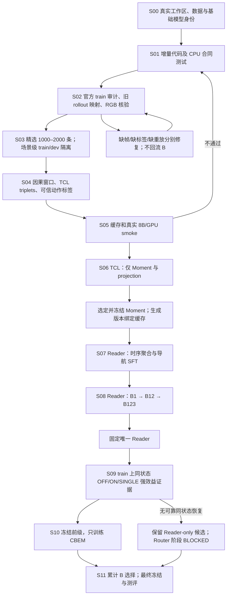
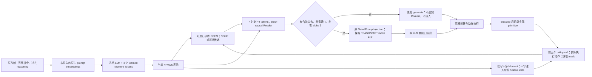

# HAMLET-v2：实现对照、分阶段训练与测评执行手册

**代码基线**：`woaijieyang/test` 的 `HAMLET-v2`，`755948f65cc030d252b808592086a0c96d2df82e`。
**本次交付**：该提交上的增量源代码、CPU 回归测试、双进程 CPU 集成检查和本执行文档。
**明确边界**：本地补丁已实现和测试；没有向远端提交，没有访问用户服务器训练数据，没有训练真实 AwareVLN 8B，没有运行 A6000 或 Habitat 导航。源码具备可执行入口不等于真实数据/模型已经验收。
**不变目标**：仅 R2R train + RxR train en-US，精选 1,000–2,000 条路线—指令样本；先识别，再训练短时 Reader，最后训练 CBEM；保持原八帧输入、REASON/ACT、动作解析和控制协议，不改 poseAdapter、graphAdapter。

## 0. 如何使用本文件

本文取代旧手册中“待实现 CLI”和推测目录的部分，保留 S00–S11 的执行顺序。每阶段先检查进入条件，再运行实际入口，最后用产物和测试决定 `PASSED / FAILED / BLOCKED`。本文件描述“代码已实现”的地方不代表该阶段真实实验已通过。当前只能将本地代码测试记为通过；真实数据、权重、GPU smoke、环境重放和导航指标应单独登记。

原手册设想复用 Hugging Face Trainer；本实现选择项目已有依赖 **Accelerate 0.27.2** 管理 DDP、混合精度和梯度累积，PyTorch 管理 AdamW、TransformerEncoder 与调度。新增 `engine.py` 仅承担阶段参数选择、小型 memory checkpoint、数据身份与采样恢复，不另写分布式通信，也不引入 RL、DPO、新优化器或新的模型训练框架。原生 AwareVLN 的 tokenizer、图像预处理、multimodal preparation 和评估器继续复用。此处是后端实现取舍，不是训练目标改变。[R1–R4]

新模型使用 `hamlet.short-memory.v1` 与 `hamlet.training-checkpoint.v1`；历史 HAMLET/CBEM 权重不被静默转换。旧 `--method hamlet` 和 baseline 继续使用原入口，新权重只通过显式的 `--method hamlet-trained --trained-bundle ...` 接入。禁止将新 checkpoint 放进旧 `models/hamlet-v2` 后假装格式兼容。

### 0.1 真实阻塞清单

| 项目 | 当前完成范围 | 尚需真实环境完成 |
|---|---|---|
| 原接口与新训练模块 | CPU 单元、梯度、恢复、运行时测试 | 真实 8B 权重与视觉塔联调 |
| 数据提取、筛选、窗口 | 可执行 CLI、分阶段修复队列、测试 | `/data/zy` 中实际 train 文件与 rollout 字段核对 |
| TCL / Reader / Router | 三阶段优化器、损失、冻结、checkpoint | 真实缓存生成及训练；不能引用测试夹具当数据 |
| B 累加评估 | 身份解析、并集、原结果转换、逐 episode 汇总 | B1/B2/B3 实际文件名与导航运行 |
| Router 强效益数据 | 原始证据校验、标签与特征生成 | 真实同状态环境恢复和终局分支采集 |
| 远端发布 | 提供基于精确 HEAD 的补丁与安全应用脚本 | 当前连接无 GitHub 写操作；远端未更新 |

**特别注意旧 rollout**：当前仓库 `src/case1_runtime/trace.py` 的 `identity()` 将 split 固定写成 `val_unseen`。这类既有测评 trace 不能改个文件名或覆盖 `source_split` 后进入训练。导入器显式拒绝 `task_key` 中的非 train 身份。合法训练数据可以来自可追溯到官方 train 的既有独立训练 rollout、expert-follow 或已核验标注；不能把模型预测动作自动当作专家标签。[R5]

## 1. 文件组织与职责

下面列出本次增量位置；省略未修改的基础代码、数据、权重与其他模块。

```text
HAMLET-v2/
├── .github/workflows/hamlet-cpu.yml             # CPU CI、双进程检查、依赖修复
├── configs/hamlet/training/
│   ├── plan.yaml                               # 三阶段默认预算与优化参数
│   └── evaluation.yaml                         # B 根目录、累计集合、候选约束
├── docs/hamlet/
│   └── HAMLET-v2_实施与训练执行手册.md
├── scripts/
│   ├── evaluate.py                             # 原评估入口增加 hamlet-trained
│   └── hamlet/
│       ├── run.sh                              # 复用 with_runtime.sh 的保护环境
│       └── test_cpu.sh                         # 编译与完整 CPU 测试
├── src/awarevln_memory/
│   ├── memory/adapter.py                       # 原接口防目标泄漏；推理签名兼容
│   ├── cbem/router.py                          # 原 scorer 直接复用，不复制重写
│   └── training/
│       ├── artifacts.py                        # 身份/hash、排除评估根、独占原子写入
│       ├── bootstrap.py                        # 从真实工作区生成运行配置
│       ├── data.py                             # 官方数据导入、能力漏斗、精选、窗口
│       ├── rollouts.py                         # 旧日志显式字段映射与身份 join
│       ├── observations.py                     # 纯 CPU RGB 文件核验
│       ├── datasets.py                         # 三阶段 Dataset、collator、split 校验
│       ├── preprocess.py                       # 原 AwareVLN 预处理和冻结特征缓存
│       ├── cache.py                            # safetensors 与不可变缓存合同
│       ├── masks.py                            # prompt/target、block-causal mask
│       ├── models.py                           # Moment、Reader、StageModel、CBEM loss
│       ├── engine.py                           # Accelerate 分阶段优化与精确恢复
│       ├── checkpoints.py                      # 小型权重、父级依赖、部署导出
│       ├── counterfactual.py                   # 强效益证据校验，不伪造模拟器
│       ├── evaluation.py                       # 累计 B、结果转换、配对诊断
│       ├── runner.py                           # 配置、数据、缓存、训练前置检查
│       └── pipeline.py                         # 已实现的统一 CLI
├── src/hamlet_v2/
│   ├── policy.py                               # 新旧权重独立绑定
│   └── trained_runtime.py                      # 新权重真实生成接口与 recent 状态
├── src/llava/
│   ├── train/train_hamlet.py                   # 薄训练入口
│   ├── train/utils.py                         # 无 labels/未初始化 distributed 防护
│   ├── train/sequence_parallel/globals.py      # DeepSpeed 仅实际使用时导入
│   └── model/                                 # 可选视觉依赖延迟导入、无标签 loss 防护
├── src/vlnce_baselines/awarevln_trainer.py       # 新 runtime opt-in；env.step 后记录实执行
└── tests/hamlet_training/
    ├── test_models.py
    ├── test_engine.py
    ├── test_data.py
    ├── test_runtime_checkpoint.py
    ├── test_evidence_cli.py
    ├── test_hardening.py
    └── distributed_probe.py                    # 明确标记 synthetic，仅 CPU 集成检查
```

工作产物全部进入新的 `${RUN_ROOT}`，默认放在当前工作区既有 `outputs/` 之下。不得放入 checkpoint-choice，不覆盖旧 checkpoint；所有新目录使用独占创建，冲突即报错而不是覆盖。原始数据文件只读。新文档不会修改历史 `AGENTS.md` 中其他案例的权限；在实际服务器上继续服从适用的工作区保护规则。

```text
${RUN_ROOT}/
├── contracts/       base_inventory.json、protocol.json、paths.lock.json、真实 smoke 证据
├── configs/         tcl.yaml、reader.yaml、router.yaml（init 生成）
├── manifests/       官方候选、排除记录、精选锁、train/memory-dev 清单
├── observations/    显式映射事件、RGB 检查、修复队列
├── datasets/        tcl、windows、router 的原始与 accepted 清单
├── cache/           prompts、moments、router（各自合同与 safetensors）
├── checkpoints/     阶段输出，不保存重复 8B 权重
├── selected/        moment、reader；仅复制已验证的小型 checkpoint
├── eval/            r2r/rxr 的 B1、B12、B123 身份与汇总
├── release/         候选推理 bundle，不等同最终验收
└── reports/         数据漏斗、smoke、选择依据、最终结果
```

## 2. 唯一主流程与在线 workflow





`recent-4` 明确定义为 `past3 + current`。候选被拒绝、缺失或 padding 时，只改变对应 mask，不把旧事件往前压缩冒充新的时间。CBEM 的分数排序不会改变送入 Reader 的时间顺序。实际 primitive 由 `record_step()` 在 `env.step()` 之后记录，模型刚提出动作时只记 proposed，不提前写成 executed。

## S00：确认基线和服务器条件

进入本阶段先运行 `git status`、`git branch --show-current`、`git rev-parse HEAD`，检查是否仍以目标提交为基础。补丁只允许普通增量应用，不 reset、不 force-push、不覆盖用户并行改动。若实际 HEAD 已变化，先逐文件合并并重跑测试；不得直接复制整个仓库快照覆盖。当前本地源码来自该提交 GitHub Actions 导出的精确 archive；交付补丁不携带数据、权重、runtime 或其他模块。

实际服务器继续使用 `scripts/with_runtime.sh`，保留它的隔离保护。`init` 要读取现有 `outputs/preflight/model.json` 和 `models/awarevln/llm/config.json`；它不会下载模型或猜权重目录。缺少这些文件应先用项目原有准备/冻结流程补齐，或将真实路径适配成当前既有工作区结构。不能用本地 CPU 小模型冒充用户基础模型预检。

```bash
# 在目标工作区的根目录执行；RUN_ROOT 必须是尚不存在的新目录。
export WORKSPACE="$PWD"
export RUN_ROOT="$WORKSPACE/outputs/hamlet-train-run01"
bash scripts/hamlet/run.sh init --workspace "$WORKSPACE" --output "$RUN_ROOT"
```

这条命令创建三份实际 YAML、base inventory、protocol 和 paths.lock。状态为 `PATHS_MATERIALIZED_NOT_TRAINING_READY`。协议固定八帧、past3+current、Moment4、mode lock、允许来源以及原代码 hash；当前干净观测编码按原生模型 loader 的 FP16 固定。SFT 可使用 BF16 反向，但不能用 BF16/FP32 生成的干净 Moment 缓存冒充部署 FP16 缓存。任何预处理、模型或协议文件改变，都要新建运行合同和缓存。

验收应核对 B 的两个真实目录，不猜 A/Remaining 的用途。B1/B2/B3 的文件名通过服务器实际目录确认后设置环境变量；本交付没有读取这些文件，也没有报告它们的数量。

## S01：安装补丁、执行原接口与训练合同检查

先执行 `bash scripts/hamlet/test_cpu.sh`，保留原 `tests/hamlet` 全部测试，同时运行新增测试。改动包含原 Adapter 的目标答案可见范围：从第一个监督 token 开始的全部后缀都不进入 Query，即使后缀中又出现 `-100` 也不能绕过限制。零记忆、NONE 和零 alpha 回到原 generate，不把额外 Moment Tokens 传给动作解码器。

训练图不使用推理的 `inference_mode`。LLM 参数冻结，但从输入 Moment/注入向量到 loss 的梯度仍保留；同时 HF 梯度检查点受 decoder 的 training 状态控制，因此不能机械地永远 `llm.eval()`。本实现保持参数冻结，在需要 checkpointing 时开启对应 training 标志并关闭 Dropout；非零 functional attention dropout 会被拒绝，避免“冻结模型”隐藏随机变化。[R3]

CPU CI 修复了原本导入普通模型就触发 DeepSpeed 的问题，并让可选视觉塔按选择分支导入。没有删除原测试或给失败测试加 skip。部署仍按原锁定依赖安装，不要求把服务器环境升级成本地测试版本。

双进程检查命令如下，仅使用明确标记的合成夹具检查分布式机制，不算导航训练：

```bash
PYTHONPATH=src OMP_NUM_THREADS=1 MKL_NUM_THREADS=1 \
python -m torch.distributed.run --standalone --nproc_per_node=2 \
  tests/hamlet_training/distributed_probe.py --output /tmp/hamlet-ddp-new-attempt
```

通过后登记 CPU 证据；S05 的真实权重/GPU验收仍未通过，不能提前签署。

## S02：审计训练数据，修复旧 rollout，而不是滥删或滥用

首先对实际训练标注运行 `audit`。命令接受官方 JSON/JSONL/gzip 以及连续版 `episodes` 结构；R2R 没有 RxR 的语言字段不被误删，连续版缺 instruction_id 时保留明确的 `ce-episode:<id>` 身份而不虚构原始 instruction ID。RxR 必须是 en-US；连续记录缺语言时，需要官方 train guide 的唯一 ID join，guide 文件 SHA 也写入来源记录。仅有英文句子或 `rxr_us` 目录名不能证明语言身份。

```bash
: "${R2R_TRAIN:?填入实际官方 train 标注}"
: "${RXR_US_TRAIN:?填入实际连续版 train 标注}"
: "${RXR_GUIDE_TRAIN:?填入官方 train guide}"
bash scripts/hamlet/run.sh audit --dataset r2r --source "$R2R_TRAIN" \
  --output "$RUN_ROOT/manifests/r2r-audit"
bash scripts/hamlet/run.sh audit --dataset rxr --source "$RXR_US_TRAIN" \
  --guide-source "$RXR_GUIDE_TRAIN" --output "$RUN_ROOT/manifests/rxr-audit"
```

这些变量是服务器上尚需定位的真实输入，不是已经创建的占位文件。原始文件一旦声明 train，还需查看官方来源和 split 证据；文件内部没有 split 时，代码无法仅靠内容证明来源。Codex 必须记录下载来源/已有 manifest，而不是把任意文件传给 `--source` 后称官方 train。

复用旧日志走 `extract-rollout`。`mapping.fields` 显式指定点路径，例如 `prompt` 指向日志真正保存的完整 prompt，`image_paths` 指向真正的图像路径，不能拼出凭空的视觉记录。若旧日志没有 route_key，可使用 `route_join` 按 scene 加 instruction/episode 身份唯一 join 到官方索引。目标字段只在原日志或已核验标注真实存在时映射；不默认 `target_source=expert`。若 raw `split/source_split` 或 native `task_key` 指向 val_unseen，即使数值 ID 恰巧重合也拒绝。

```bash
# 对每个有合法 train 来源的日志分别调用，输出目录不覆盖。
bash scripts/hamlet/run.sh extract-rollout --source "$TRAIN_ROLLOUT" \
  --routes "$RUN_ROOT/manifests/r2r-audit/candidates.jsonl" \
  --mapping "$ROLLOUT_MAPPING_JSON" --output "$RUN_ROOT/observations/import-r2r01"
```

必须具备的事件字段是 `event_id, rollout_id, call_id, prompt, image_paths, image_call_ids, protocol_identity`，以及 route_key 或唯一 route_join。call 从1开始，图像时间不大于当前 call，完整 prompt 不包含当前 target。旧 trace 没保存逐图时间、协议身份或可信标签时，进入修复队列；不能由 Codex猜测。映射文件应和原始日志一起保存 hash。对同一任务的 REASON/ACT 调用保持真实调用 ID，不改变其执行次序。

事件合并后执行 `audit-observations`。它纯 CPU 打开真实 PNG/JPEG、校验尺寸与 SHA，保留原八帧采样中合法的重复路径。缺图不使整条路线永久删除，而输出具体 event/slot 修复记录。人工看图核验地标和指令一致性仍需要进行；RGB可解码不等于语义标签正确。

```bash
bash scripts/hamlet/run.sh audit-observations --events "$MERGED_TRAIN_EVENTS" \
  --output "$RUN_ROOT/observations/rgb-audit"
```

本阶段按 observation、ACT、REASON、replay 分开统计能力。缺 reasoning 的记录可用于 ACT；无可信动作的合法观察保留为观测资产；无同状态恢复只阻塞强效益分支。当前主精选池需要存在合法 ACT 样本，TCL-only 资产留在审计清单中，不擅自扩大本次 route 白名单。若因旧日志全是 val_unseen 导致 train 不足，正确动作是获取对应官方 train 派生轨迹或在已授权 train 环境补采，不是降低 split 门槛。

## S03：锁定高价值路线和 train/memory-dev

使用已完成 RGB 核验的事件与官方候选清单运行 `select`，默认总量1500，分别为R2R/RxR各750，包含内部 dev。先按 scene 划定两侧，再仅用 train 侧拟合分位秩；dev 分位超界裁剪到[0,1]，不重新拟合。跨数据集相同 scene/有序 path 归同一家族，反向路径不被误并，同家族优先1条，填补合法缺口时最多2条。

```bash
bash scripts/hamlet/run.sh select \
  --routes "$RUN_ROOT/manifests/r2r-audit/candidates.jsonl" \
           "$RUN_ROOT/manifests/rxr-audit/candidates.jsonl" \
  --events "$RUN_ROOT/observations/rgb-audit/ready_events.jsonl" \
  --total 1500 --seed 42 --output "$RUN_ROOT/manifests/selected"
```

评分仍为 `0.25L+0.20G+0.20T+0.15A+0.10V+0.10Q`。L 使用路径长度代理分位，中长程高于极端长程；G 为固定词典中的房间/物体与先后关系计数；T 为实际动作块切换，A 为左右转向变化；Q 为可用观察覆盖。V 只接受真实记录的视觉多样性分数，本交付没有训练新的视觉聚类器；缺 V 时记录 missing 并对其余权重重归一化，不能把0.5当成测得值。G/T等均是选择启发式，不声称已证明记忆有收益。

按照 grounded35%、turns25%、confusable20%、ordinary20% 做分层，先限制场景与家族集中，再在不足时按已声明顺序放宽配额/场景软上限；不放宽语言、split、标签可信度。`selected.lock.json` 保存原始分数、归一化统计、缺项、实际数量和不足原因。至少按来源人工抽查50条；若标签或时间顺序错，回到S02修规则。

`--total 1000` 中还包含 dev，因此不保证实际 train 满1000。本实现只有实际 train≥1000 才给生产选择 `READY`；不足时可在2000总预算内补选，不能把dev迁回。`--pilot` 只允许小样本工程检查，不可将其结果称正式训练。

## S04：生成因果窗口、TCL triplets 和可信监督

`windows` 同时生成已验证事件、TCL triplets、SFT窗口与排除记录。每个 route 最多12个 anchor，限制跨多个 rollout 版本累计生效，不让长RxR或同一路线重复采集支配更新。事件中保存的是现有完整八帧 prompt；数据集不会在模型输入侧读取GT路径、位置或未来动作。

```bash
bash scripts/hamlet/run.sh windows --routes "$RUN_ROOT/manifests/selected/selected.jsonl" \
  --events "$RUN_ROOT/observations/rgb-audit/ready_events.jsonl" \
  --max-anchors 12 --output "$RUN_ROOT/datasets/raw"
```

SFT过去槽位严格为 `t−3,t−2,t−1`，当前为t；缺call保持None。目标仅接受 `expert/verified_correction/verified_annotation` 且具备 provenance。当前 target_text 与 stop_text 必须采用原生模式 token 和真实 conversation终止符；不创造新的动作词表。缺reason不补写生成的“真值”。失败轨迹的观察可保留，其原错误动作不能自动成为正确目标。

TCL使用同event轻度增强正例、同路线/同rollout不同地点负例。当前实现以训练期可信米制位置距离≥2米、不同viewpoint过滤负例；没有可信坐标则标记无验证空间负例，仅阻塞该TCL样本。训练位置只参与triplet筛选，不进入prompt/Moment/Router。若输入位置单位不明确，先在S02修正并记录单位；不要把未知坐标直接当米。重复地点不作为普通负例。样本来自同一批选中train路线；memory-dev保持同样scene隔离，所有阶段共享该归属。

## S05：缓存、梯度与真实模型 smoke

`init` 生成的配置默认指向最终 accepted清单；第一次audit-cache前，应复制阶段配置为新的“prepare配置”，将其 `rows` 指向S04原始清单。不要修改已开始训练的配置。`cache-prompts` 复用原 tokenizer、图像处理和 multimodal preparation，缓存不含target的prompt embeddings；TCL正例只轻微改变当前帧，不改变过去七帧或文本。target_ids作为独立张量保存，mode与锁定baseline不兼容时只保留观察，SFT阶段拒绝该target。

```bash
bash scripts/hamlet/run.sh cache-prompts --config "$RUN_ROOT/configs/tcl.yaml" \
  --events "$RUN_ROOT/datasets/raw/events.jsonl" --triplets "$RUN_ROOT/datasets/raw/tcl.jsonl" \
  --windows "$RUN_ROOT/datasets/raw/windows.jsonl" --output "$RUN_ROOT/cache/prompts"
# 使用rows指向datasets/raw/tcl.jsonl的真实prepare配置进行审计。
bash scripts/hamlet/run.sh audit-cache --config "$TCL_PREPARE_CONFIG" \
  --output "$RUN_ROOT/datasets/tcl-audit"
# 将实际accepted.jsonl作为正式tcl配置的rows，或独占复制到init规定的accepted路径。
bash scripts/hamlet/run.sh train --config "$TCL_RUN_CONFIG" --dry-run
```

旧rollout的capture protocol与本次encoding protocol分别保存。旧策略/源码SHA不同不会自动使原始train图像失效；所有图像与prompt必须用当前锁定tokenizer和视觉塔重新编码，绝不直接复用旧hidden states。preservation只接受与当前base identity相符的baseline正确性证明。prompt缓存只编码TCL/Reader窗口引用的事件并集，而不是全路线所有调用；Moment缓存读取实际成功的cached_events.jsonl。八帧prompt embeddings仍可能很大，先用独立小样本cache统计平均字节与可用磁盘，再决定全量缓存；不得以“两张GPU足够”推断磁盘足够。所有特征缓存写入safetensors和逐项SHA，合同绑定base、protocol、来源清单以及Moment/Reader父checkpoint。metadata含input_identity与图像hash；跨split、污染或stale缓存会报错。缺过去缓存可以在Reader `audit-cache --mask-missing-past` 时显式置None并留下slot修复记录；损坏/错版本缓存不会被此选项伪装成缺帧。禁止Dataset在训练到一半时静默跳过bad sample。

dry-run会分别报告每阶段实际窗口、独立路线—指令、family、scene和来源计数。TCL/Reader正式训练若在缓存与标签审计后剩余train路线—指令不足1000会阻止启动，Router不机械要求每个pair来自独立路线。真实smoke在小型、来源合法的train子集上执行。用独立diagnostic配置设小step_cap和新output，先单卡检查，再双卡检查；正式配置的expected_world_size不匹配启动进程数时会拒绝。首轮每卡micro1；不能将两张48GB当作一张96GB。保存峰值显存、输入长度、梯度、非有限输出、空记忆回退、reset及训练/在线前缀一致性证据。

```bash
# 真实2卡诊断；DIAGNOSTIC_CONFIG的预算与输出必须独立，不能覆盖生产run。
bash scripts/with_runtime.sh python -m torch.distributed.run --standalone --nproc_per_node=2 \
  src/llava/train/train_hamlet.py --config "$DIAGNOSTIC_CONFIG" --diagnostic
```

`train --diagnostic` 不宣称验收。生产run要求 `smoke_gate` 的status、contract和原始证据hash完全匹配，且evidence非空。smoke_gate由Codex依据真实检查登记，不可复制本文或测试fixture伪造。CPU测试没有签署此gate。未通过则回到数据/注入接口修复，不以增大训练step掩盖。

## S06：TCL识别训练和Moment选择

只更新 `moment.tokens` 与 `moment.projection`，基础LLM、视觉塔、原mm projector、Reader、CBEM全部冻结。默认temperature0.07，每个anchor有一个增强正例和一个过滤负例，不把梯度累积误说成提供更多in-batch negatives。四个完整Moment保留给部署，projection仅服务TCL损失。

默认epochs上限5、step_cap5000、每卡micro1、两卡累积16，有效batch32；AdamW lr1e-5、weight_decay0.01、warmup3%、cosine、clip1。实际步数为 `min(cap, ceil(N×epochs/effective_batch))`，日志同时报告实际曝光上界。1500条路线不能被固定“跑8000步”替代；N是审核后的triplets数量，不是路线数。

```bash
bash scripts/with_runtime.sh python -m torch.distributed.run --standalone --nproc_per_node=2 \
  src/llava/train/train_hamlet.py --config "$TCL_RUN_CONFIG"
```

内部dev评估TCL loss、positive rank/margin、未经过projection的Moment跨样本方差；检查各来源和重访子集，排除只有projection优化、原表示塌缩的情况。连续两次评估不改善即早停。选择一份有明确诊断依据的checkpoint，用下列命令复制小型权重，不复制optimizer/8B基础模型。

```bash
bash scripts/hamlet/run.sh select-checkpoint --source "$TCL_CHOSEN_CHECKPOINT" \
  --output "$RUN_ROOT/selected/moment"
```

复制不是通过验收，另存selection依据。Stage2必须加载该父SHA且冻结Moment。生产H4096/D768默认下，本阶段可训练参数4,243,712，实际以dry-run逐参数清单为准。

## S07：冻结Moment，训练Recent-4 Reader

先生成选定Moment版本的缓存。缓存编码采用协议锁定的原生精度，不随训练mixed_precision自动改变。Stage2从TCL父checkpoint继承Moment，训练Reader时不重新更新Moment，因此缓存可安全复用；没有隐含的联合微调路径。未来要联合更新必须新实验、新缓存协议，不能修改已封存run。

```bash
bash scripts/hamlet/run.sh cache-moments --config "$RUN_ROOT/configs/reader.yaml" \
  --events "$RUN_ROOT/cache/prompts/cached_events.jsonl" --output "$RUN_ROOT/cache/moments"
bash scripts/hamlet/run.sh audit-cache --config "$READER_PREPARE_CONFIG" \
  --mask-missing-past --output "$RUN_ROOT/datasets/reader-audit"
bash scripts/hamlet/run.sh train --config "$READER_RUN_CONFIG" --dry-run
bash scripts/with_runtime.sh python -m torch.distributed.run --standalone --nproc_per_node=2 \
  src/llava/train/train_hamlet.py --config "$READER_RUN_CONFIG"
```

Reader为两层、hidden768、heads12。每时刻四token不平均成一个输入；仅CBEM路由key可以pool，不用于代替时序表示。block-causal mask允许同一时刻四槽互相注意，禁止未来时刻影响过去。动作编码区分停止/前进/左右转、已确认无动作，以及混合或未知序列；不把缺失执行日志当成已确认未移动。

仅更新 `reader.down/slot/age/action/temporal/norm/gate/injection`，Moment/TCL head/CBEM和基础模型冻结。默认lr5e-5，gate及alpha2e-5；epochs4、cap5000、micro1、两卡累积8，有效batch16；完整memory dropout0.1。默认可训练参数21,854,978。损失按样本有效target token归一：ACT权重1、REASON权重0.3；验证过baseline正确的样本可启用0.1 preservation KL，不对待纠错状态无条件强迫模仿基线。

alpha初值0用于保护原行为；第一步先给alpha梯度，后续才驱动Reader，并非代码断梯度。测试已验证这一先后。没有合法过去的样本读门严格为0；只有当前Moment不会替代原baseline。内部dev保存ACT/REASON loss和读概率，同时执行正确历史/打乱历史/删除历史对照。最多取3个Reader checkpoint进入S08，不因loss最低就直接称导航有效。

## S08：Reader的累计B粗筛与细筛

用户目录严格只读：

```text
/data/zy/vln/data/checkpoint-choice/VLN-awareVLN/B/r2r/
/data/zy/vln/data/checkpoint-choice/VLN-awareVLN/B/rxr_us/
```

`b-index`接受真实ID列表或连续版episode记录，回查权威val-unseen标注解析dataset/scene/instruction/episode身份；RxR强制en-US。三份如果互斥则取并集，若已经嵌套则保持同一累计语义；无依据的部分重叠报错。不能仅对三个SR做平均。

```bash
bash scripts/hamlet/run.sh b-index --dataset r2r --annotations "$R2R_UNSEEN_ANNOTATIONS" \
  --b1 "$R2R_B1" --b2 "$R2R_B2" --b3 "$R2R_B3" --output "$RUN_ROOT/eval/r2r/index"
bash scripts/hamlet/run.sh b-index --dataset rxr --annotations "$RXR_UNSEEN_ANNOTATIONS" \
  --b1 "$RXR_B1" --b2 "$RXR_B2" --b3 "$RXR_B3" --output "$RUN_ROOT/eval/rxr/index"
```

候选先导出workspace内的不可变bundle。保持原baseline环境preflight/工程gate，不以新命令绕过保护。

```bash
bash scripts/hamlet/run.sh export --checkpoint "$READER_CANDIDATE" \
  --inventory "$RUN_ROOT/contracts/base_inventory.json" --protocol "$RUN_ROOT/contracts/protocol.json" \
  --output "$RUN_ROOT/release/reader-candidate01"
bash scripts/with_runtime.sh python scripts/evaluate.py --dataset r2r --method hamlet-trained \
  --trained-bundle "$RUN_ROOT/release/reader-candidate01" \
  --run-id hamlet-reader01-r2r-B1 --profile "$NATIVE_NAVMESH_PROFILE" --scope diagnostic \
  --episode-ids "$RUN_ROOT/eval/r2r/index/B1.ids.json" --gpu-ids "$GPU_IDS"
```

上例GPU_IDS必须先根据服务器保护规则和实际两张可用物理卡确定，不预设服务器卡号。RxR同样执行。相同source/model/protocol/episode下已完成B1可复用，只补B2或B3的增量ID；模型、阈值、环境或source改动后必须重算。native结果通过 `b-convert-results` 转成canonical episode行，仍使用原sr/spl/ndtw/ne，不重新定义指标。

```bash
bash scripts/hamlet/run.sh b-convert-results --expected "$RUN_ROOT/eval/r2r/index/B1.jsonl" \
  --run "$WORKSPACE/outputs/hamlet-reader01-r2r-B1" --output "$RUN_ROOT/eval/r2r/reader01-B1.jsonl"
# B12/B123的expected分别使用累计清单；results传此前与新增分片的canonical文件。
bash scripts/hamlet/run.sh b-aggregate --expected "$RUN_ROOT/eval/r2r/index/B12.jsonl" \
  --results "$B1_CANONICAL_RESULTS" "$B2_CANONICAL_RESULTS" \
  --checkpoint-sha "$NATIVE_MODEL_SHA" --protocol-sha "$NATIVE_EVAL_PROTOCOL_SHA" \
  --output "$RUN_ROOT/eval/r2r/reader01-B12-summary.json"
```

SHA取自转换结果/真实manifest，不使用训练checkpoint SHA替代native模型组合SHA。汇总必须覆盖全部expected；失败或缺失episode不能从分母删除。同一episode完全相同的重复记录可去重，有冲突则报错。B1最多3候选，B12/B123最多2候选。Reader阶段筛选约束为每数据集SR下降不超过1pp、SPL/nDTW下降不超过2pp；这只是有限筛选容忍，不是“有效”的统计证明。必须另有历史依赖诊断正向证据。按双数据集macro SR、SPL、nDTW顺序择优，冻结唯一Reader后才进入S09。

## S09：固定Reader，建立真实记忆效益监督

本实现提供 `label-router` 与 `cache-router`，不提供一个虚假的“万能Habitat快照接口”。当前分支没有可验证的完整train同状态重放资产，服务器需将既有环境恢复、模型memory、队列和RNG通过真实接口采集为分支记录。只恢复agent位置和RGB不够；没有完整恢复能力时本阶段应BLOCKED，保留Reader-only候选，不用局部action loss假装终局收益。

每个anchor绑定唯一Reader、当前输入、候选过去三槽、continuation policy和train身份。强证据要求相同初始state各组成hash：RGB、pose、primitive_step、action_queue、image_history、reasoning、memory、Python/NumPy/Torch RNG、environment。每次只干预当前读取，后续使用同一冻结策略，运行到terminal。OFF提供基准；ON只监督集合使用决策；SINGLE才监督某条候选。REMOVE/REPLACE或局部horizon只作诊断，不擅自转换为单条强效益标签。

标签先比较二元成功；同成功下仅在nDTW超过1pp且SPL不下降时给正效益，反向同理，其余neutral。这个规则是本项目预注册启发式，不是通用奖励定理。原始分支JSON与evidence SHA必须一致，改汇总数字但不改证据会被拒绝。未知候选与已测neutral分开mask，不把未测条目批量标NONE。

```bash
bash scripts/hamlet/run.sh label-router --anchors "$REAL_TRAIN_ANCHORS" \
  --branches "$REAL_TERMINAL_BRANCHES" --reader "$RUN_ROOT/selected/reader" \
  --output "$RUN_ROOT/datasets/router-labels"
bash scripts/hamlet/run.sh cache-router --config "$ROUTER_RUN_CONFIG" \
  --labels "$RUN_ROOT/datasets/router-labels/labels.jsonl" --output "$RUN_ROOT/cache/router"
```

先300–500有效anchor pilot，再按预算增至1000–2000。记录候选、有效、neutral、uncertain漏斗，不能靠压缩tie band制造监督。所有分支只来自选定train侧；memory-dev分支只做评估，B不参与任何效益采集。

## S10：仅更新CBEM Router

本阶段复用仓库 `CBEMRouter` 的候选scorer和NONE机制，最近三条是固定候选，不启用archive-256。唯一更新组 `router.*`，默认233,730参数。Moment、Reader、gate与injection scale都保持父checkpoint状态；Router特征/标签必须携带该Reader SHA，父级不一致即拒绝训练。

训练直接监督候选logit相对NONE的margin，以及runtime同一max-vs-NONE集合决策；不试图从离散topk动作路径反传训练router。已测helpful/harmful对应1/0，neutral对应0.5并降低权重，未测候选不参与单条loss。整体ON/OFF收益不复制给每条记忆。默认lr1e-4、AdamW、batch32、单进程、epochs上限20且stepcap1000、dev间隔50、patience3。

```bash
bash scripts/hamlet/run.sh train --config "$ROUTER_RUN_CONFIG" --dry-run
bash scripts/hamlet/run.sh train --config "$ROUTER_RUN_CONFIG"
```

内部dev记录helpful_use、harmful_use、neutral_use，不把全NONE的高准确率称有效。完整precision/recall需根据实际标签覆盖另做明细统计，当前代码不伪造没有标签的指标。最多两个Router候选进入S11；同一候选不得换Reader后继续沿用原分支标签。

## S11：累计选择最终组合、冻结与归档

使用同一B1→B12→B123管线，比较同协议baseline、固定Reader-only及至多两个Reader+Router候选。最终选择要求两个数据集SR均不下降、macro SR严格正增益、各自SPL/nDTW下降不超过1pp；没有合格候选则返回baseline，不强制把新模型列为最佳。阈值固定在代码和evaluation配置中，改变它们必须另起实验并重做合同，不能看B成绩后偷偷改。

`b-select`输入为两个数据集汇总组成的baseline JSON，以及 `{候选名:{r2r:汇总,rxr:汇总}}`。输入必须有相同episode集合hash、protocol和样本数；B1结果只用于淘汰，最终结论以B123为准。模块提供paired_report统计rescued/harmed与按scene聚类bootstrap，少场景时只作描述，不夸大显著性。

```bash
bash scripts/hamlet/run.sh b-select --baseline "$BASELINE_SUMMARIES" \
  --candidates "$CANDIDATE_SUMMARIES" --stage final \
  --output "$RUN_ROOT/reports/final-selection.json"
bash scripts/hamlet/run.sh export --checkpoint "$FINAL_CHECKPOINT" \
  --inventory "$RUN_ROOT/contracts/base_inventory.json" --protocol "$RUN_ROOT/contracts/protocol.json" \
  --use-router --output "$RUN_ROOT/release/final-candidate"
```

Reader-only导出时不要传`--use-router`。导出status仍为`CANDIDATE_PENDING_NAVIGATION_VALIDATION`；只有实际导航验收报告才能说明成功。A/Remaining是否独立必须先核对历史使用情况，不默认它们是未见测试集。最终报告保存原episode结果、base与新模型配置、源码SHA、环境/navmesh身份、显存/延迟和负向案例，不清理失败证据。

## 3. 阶段参数、数据重叠与预算总表

| 项目 | TCL | Reader | Router |
|---|---|---|---|
| 底层路线 | 统一selected train | 同一selected train | 同一train中的反事实anchor |
| 内部开发 | 固定memory-dev | 固定memory-dev | 固定memory-dev分支 |
| B使用 | 无训练/无负例 | 仅S08选模 | 仅S11选模 |
| 更新 | Moment tokens + projection | Reader及其投影/位置/动作/gate/injection | 原CBEM参数 |
| 冻结 | 基础模型、Reader、CBEM | 基础模型、Moment、CBEM | 基础模型、Moment、Reader |
| effective batch | 32 | 16 | 32 |
| epochs / step cap | 5 / 5000 | 4 / 5000 | 20 / 1000 |
| 主lr | 1e-5 | 5e-5；gate/alpha2e-5 | 1e-4 |
| dev间隔 / patience | 100 / 2 | 100 / 2 | 50 / 3 |

步数按审核后的真实样本数计算，不预设必跑满cap。训练采样在R2R/RxR间平衡，再在route family间均衡，不按窗口数量天然偏向长RxR。首轮最多一个TCL主run、一个Reader主run、一个Router主run；多checkpoint不等于重新跑多个独立训练。小数据还需报告路线/scene数，不能把同一路线12窗口称12条独立路线。

训练精度当前只允许no/bf16；FP16干净编码与FP16优化是两回事，未保存GradScaler的FP16训练会被拒绝。checkpoint只存memory小型state_dict和父级hash。训练状态另外保存optimizer/scheduler、全局step、固定采样序列hash和每rank RNG；resume检查数据、父级、世界大小、预算和配置一致。恢复需使用新输出目录或原run未冲突位置；原文件不可覆盖。当前CPU测试已经验证从step2恢复到step4与不中断训练逐张量完全一致；不同GPU/库版本下的数值一致性仍需实测。

## 4. 复用来源、实现取舍与风险

[R1] HAMLET官方N1.5实现：<https://github.com/myungkyuKoo/HAMLET-Isaac-GR00T/tree/n1.5>。复用Moment/TCL与时序模块设计，不复制GR00T动作专家，也不把其操作任务成绩外推为VLN收益。

[R2] Accelerate 0.27.2梯度累积：<https://huggingface.co/docs/accelerate/v0.27.2/en/usage_guides/gradient_accumulation>。本实现实际调用Accelerator、accumulate/backward/prepare和DDP，而非仅在文档提到框架。

[R3] PyTorch Autograd：<https://docs.pytorch.org/docs/stable/notes/autograd.html>。冻结参数与禁用计算图是不同操作；新tokens/注入向量需要梯度通过冻结decoder。

[R4] AwareVLN官方实现：<https://github.com/GWxuan/AwareVLN>；实际复用以当前用户分支锁定版本为准，不执行升级到最新官方代码。

[R5] 本次审计的原生TraceRecorder：<https://github.com/woaijieyang/test/blob/755948f65cc030d252b808592086a0c96d2df82e/src/case1_runtime/trace.py>。其val-unseen身份说明旧测评轨迹不能回流训练。

[R6] 原分支CPU CI：<https://github.com/woaijieyang/test/actions/runs/44921470525>。原失败发生在DeepSpeed导入阶段，本补丁修复依赖触发并保留原测试；远端新CI尚未运行。

本次不声称完整实现论文所有训练技巧，也不保证SR提升。强反事实采集器依赖真实环境全状态接口，目前交付的是证据校验/训练端；若该接口不存在，不能用虚构snapshot/restore函数使文档看起来闭环。真实数据来源、GPU smoke和导航是阶段门槛，不属于可用单元测试替代的事项。

## 5. Codex接手的下一步

先应用增量补丁并运行CPU测试，不启动GPU训练。随后按S00定位真实工作区，按S02审计官方train和实际日志，重点确认旧rollout是否确实属于train及是否保存完整prompt/图像/时间。把有效数量漏斗与缺项原因写入报告后再进入S03/S04。只有S05真实模型smoke通过才能优化参数；有阻塞应精确登记缺失资产或接口，不让数据边界和验收要求变成可跳过的开关。

## 6. 独立复审补充：缓存、split、dtype 与失败清理

这一节是训练前必须执行的防护规则，补充而不替代 S00–S11。它不是新的算法阶段，也不改变历史 HAMLET-Z/CBEM 的默认部署行为。

**特征缓存与断点身份。** 每次 `runner.stage_datasets()` 在验证 train/memory-dev 的所有实际消耗样本之后，生成**精确 read-set** 的 SHA256 身份：TCL 包含 anchor、positive、negative 的 prompt 缓存；Reader 包含 current prompt、current/past Moment 缓存；Router 包含实际读取的 router-feature 缓存。为每个 key 校验分区、缓存合同、tensor 文件 SHA 和 metadata 文件 SHA。`data_identity` 将其纳入训练/恢复合同。同一个根目录中新增加的、未被本次训练消费的特征不会导致漂移；但如果一个已消费 payload 和 sidecar metadata 都被替换，下一次训练或 resume 将因身份变化而拒绝原 checkpoint。这里实现的是数据身份的确定性绑定，不是并发写入时的锁定机制；训练期间仍禁止其他进程修改缓存。

**旧 rollout 的 split 证明。** 将官方 train annotation 的 route_key join 成功，仅能证明“可能对应某条 train route”，并不能证明观察记录本身来自 train。新导入器要求原记录含 `source_split=train`、`split=train` 或 native `task_key` 中合法的 `|train|` 段。缺失这些来源证据的记录标记为 `ROLLOUT_SPLIT_UNVERIFIED` 进入修复队列；不得由 Codex 根据目录名或任务 ID 猜测 split。已明确 val-unseen 的记录仍严格拒绝。此变更可能降低可用旧 rollout 数量，但不会静默把评测数据当作训练输入。

**Moments 的数值精度。** `bootstrap.initialize()` 为当前训练协议保存 `clean_encoding_dtype`。运行时 `TrainedHAMLETRuntime` 用真实 LLM 参数 dtype 与之比较；不一致时报错，不会自动把旧缓存当作等价特征继续运行。若训练时用 BF16、推理为 FP16，必须先完成真实模型的精度漂移验证；不能直接删除这一检查以获得表面“可运行”。缺少该字段的早期合成测试 bundle 仍可解析，但本训练流程产生的正式协议必须包含它。

**初始化失败不遗留目录。** 在调用独占 `new_run_dir()` 前先验证模型 preflight、权重清单、模型隐藏维度、源码文件和训练计划。若来源缺失，直接失败，原计划输出目录保持不存在；避免需要删除用户已有的半成品目录才能重试。

**验证范围与发布状态。** 本增量改动经过针对上述边界的 CPU 单元测试、语法检查和独立 Git 补丁重放。由于审计容器缺少 Transformers/Accelerate 及真实 AwareVLN 权重，这里不声称已经复跑既往全套 81 项回归或完成 8B/CUDA/真实 Habitat 验收。前次包中的 81 项测试结果属于前一补丁版本；新的修改必须在目标服务器按 `bash scripts/hamlet/test_cpu.sh` 重新执行全部测试，再以两张 A6000 做实际 S05 smoke 和训练/推理一致性检查。任何失败必须保留报告并阻止进入正式训练。

**训练—部署精度合同。** 初始 native clean encoding 固定为 `float16`；原训练 plan 曾指定 `mixed_precision: bf16`，会改变冻结 decoder 计算语义，不能未经验证混用。本次将 TCL/Reader 默认改为 `mixed_precision: no`，训练加载 LLM 时强制使用 protocol 中的 clean encoding dtype，同时在启动前拒绝 BF16 autocast + 非 BF16 协议。此改动只对新增训练路径生效，不修改历史 AwareVLN/HAMLET 推理精度。如果将来需要全 BF16 训练，必须独立锁定 BF16 protocol、重建 prompt/moment 缓存并进行真实 8B/GPU 数值验证；在目前两张 A6000 上先使用 S05 小步 profiling 检查 FP16 冻结解码器的梯度与溢出风险，若不稳定应停止而不是删除检查。

## 7. 增量复审：TCL 可用数据、训练证据与崩溃恢复（2026-11-23）

本节补充 S02–S07 的真实代码接口与验证口径，不覆盖前文已锁定的训练/评估流程。本轮继续保留 `HAMLET-baseline` 旧推理与 `hamlet-trained` 显式 opt-in 隔离，不修改 `poseAdapter`、`graphAdapter`、八帧输入、REASON/ACT token、原始动作解析与环境测评。以下功能为本地源码改动，不代表远端分支已发布，也不代表训练指标已提升。

### 7.1 S02/S03：为什么旧 train rollout 缺少位置时不应全部淘汰

先前 `tcl_triplets()` 只在每一条 train rollout 的 `training_position` 能提供有效三维坐标、两时刻空间距离达到门槛时创建 TCL 负样本。这个行为安全但覆盖范围可能严重不足：历史 rollout 可以有完整 RGB、八帧采样、调用时序，却缺少结构化位置。仅为了 TCL 负样本剔除这些序列，会把可用于 Reader 的合法 train 观察无谓删除。**缺少位置不等于数据无效，但也不能冒充拥有已验证的空间距离。**

更新后的后备策略按如下严格顺序执行。先在**同一 rollout** 内找有真实训练位置且距离足够远、viewpoint 不相同的时间负样本，标记 `negative_type=verified_spatial_same_rollout`；只有这一步失败且启用后备时，才从**相同 partition、相同 dataset、不同 scene 的官方 train 观察**选取负样本，标记 `negative_type=cross_scene_train_fallback`，同时记录 `negative_route_key` 和 `negative_scene`。后一种监督只具备“跨场景地点差异”的证据，**不等价于 HAMLET 原论文的轨迹内时间对比**，不得把二者混称为一种样本。在一切场景/分区条件都不满足时，写入 `NO_SPATIAL_OR_SCENE_DISJOINT_NEGATIVE` 修复清单，绝不猜造位置、跨 dev 选负例或使用 val-unseen 图像。

`StageDataset` 同步区分两种负例的取数合同。空间负例必须来自当前 route，跨场景负例必须与记录的负例 route/scene 完全一致，且 metadata 证明它与 anchor 处于相同的 train/memory-dev 分区和同一数据集。TCL 的 anchor 与 positive 仍要求相同观察、相同 route，正样本由当前帧的轻微增强生成。`prepare_event()` 必须将 `scene`、`family` 和 `image_call_ids` 写入缓存 sidecar，否则虽然 triplet manifest 合法，实际取数仍会失败。`windows` 现在输出 `tcl_negative_types` 统计，选模报告必须分别列出两类比例与漏斗。建议首轮将“仅空间负例”和“空间+跨场景后备”作为两组独立 TCL 对照；若后备占绝大多数，不能把单纯地点区分能力提高解释为“时序记忆已学会”。

可复用的官方 RxR 数据字段为 `split`、`instruction_id`、`language`、`path_id`、`scan`、`path`、`heading`、`instruction`、`timed_instruction`。本实验**只允许 `split=train` 且 `language=en-US`**。RxR guide annotations 的权威结构见 <https://github.com/google-research-datasets/RxR>。R2R 官方 train 则按其合法原始 train 清单读取，不能根据旧 val-unseen trace 改写 split。训练数据清单必须保存原始来源文件 SHA、route family、合法分区、RGB 资产 SHA 以及每条排除原因。

### 7.2 S04：防止目标答案经文本间接进入历史 Query

在 `validate_events()` 和 `prepare_event()` 两处都必须检查 `prompt_contains_target` 显式标记；还要检测目标答案的完整原文是否作为子串出现在当前 prompt 中。前者是上游生产者断言，后者是独立的低成本负例检查。发现完整答案时直接抛错，不生成任何 Moment/SFT 缓存。不能以“只在最后四个 prompt token 注入”替代 Query 的目标可见范围隔离；当前 target 的 action/reasoning 输出不允许进入当前 Query、Moment 或过去动作。普通方向词/地标词可能合法出现在 instruction 中，不能把关键词重合误判成泄漏，因此子串检查只针对完整 target，而不是所有相同词。

训练窗口必须按同一 rollout 的真实 `call_id` 排序，遇到缺失调用保留空位和 `past_valid=False`，不能把三个现存调用压成连续三次历史；`image_call_ids` 不得大于当前调用。REASON 与 ACT 在同一 observation 上的调用顺序必须由 Runtime 原生身份决定，不能将模型建议的 action 提前写为 `executed_actions`。`target_source` 必须是可信 expert/已验证纠正/已验证 annotation，且拥有可追溯的来源描述；不能从自然语言指令推导一条自称专家的动作。

### 7.3 S05：缓存的故障恢复与写入一致性

缓存创建采用 fail-closed 策略：完成模型与协议预检查后才创建输出根目录。对 `cache-prompts`，先装载当前原生 AwareVLN 模型，校验真实解码器 dtype、原始 mode token IDs，再创建特征库；对 `cache-moments`，先装载父级 Moment、真实 decoder、检查所有需要的 prompt cache 元素，然后创建输出库。避免在常见的源模型不存在、缓存缺失和协议不匹配场景留下只有 `contract.json` 的半成品目录。

`FeatureStore.put()` 先以不可覆盖的原子硬链接发布 `.safetensors`，随后发布 `.json` sidecar；如果 sidecar 失败，会撤销本次创建的 `.safetensors`，使用户可以在新的、已验证的缓存任务中重试。已存在的资产仍不可自动覆盖；因为并行写入/磁盘中断也可能需要额外的恢复审计，不能宣称整个多文件缓存写入具备事务原子性。读取时继续验证 payload SHA、metadata 来源和 tensor shape；正式训练/断点恢复绑定精确 read-set SHA，避免用户更换特征却复用旧优化器状态。

`export_bundle()` 在创建 bundle 目录之前先完成父级 checkpoint、stage、路由开关、权重清单和协议 identity 的校验。任何前置失败都应保持输出目录不存在，不要求删除已有用户产物。成功导出也只能记为 `CANDIDATE_PENDING_NAVIGATION_VALIDATION`，不能因为文件齐全就声明具备真实导航能力。

### 7.4 S06/S07：不用 GPU 也可验证的真实梯度链路

新增纯 PyTorch 小型因果 Decoder fixture，不依赖 Transformers 或模型权重，用于验证两类必要事实。TCL 阶段冻结假 Decoder 的所有参数，Moment Token 和 TCL 投影头接受当前三元组损失；反向传播后要求 Moment Tokens 梯度有限、非零，而 backbone 与 Reader 梯度为空。Reader 阶段先用 `alpha=0` 检查初始可学习门的梯度，再设置非零 alpha，要求 Reader 的 down-projection 获得非零梯度；空历史样本必须有 `read_probability=0` 且注入前后 prompt 精确一致。这组测试只能证明计算图在模拟维度下连通，**不能代替真实 8B 的模式 token、FP16 数值、显存和在线动作回环验收**。

正式 S05 需要在两张 A6000 上用锁定模型做至少一次小规模 smoke：核对模型装载路径、原八帧 preprocess、Prompt/Target 可见范围、4 Moment × recent-4 时序编码、梯度是否溢出、冻结参数是否真的不更新、重复输入离线缓存与在线推理是否一致，以及 REASON/ACT 输出经过原 parser 后能成功执行。若任意不一致，记为 BLOCKED 并保留日志，不启动 S06/S07 大训练；不得用全新随机小模型的通过结果替代这一门槛。

### 7.5 检查、记录和发布的具体命令

在包含依赖的目标运行时执行以下检查，原始与新增测试必须**同时通过**：

```bash
cd "$WORKSPACE"
bash scripts/hamlet/test_cpu.sh
python -m compileall -q src/awarevln_memory src/hamlet_v2 src/llava/train/train_hamlet.py
```

若缺少 Transformers/Accelerate，允许先在纯 PyTorch CPU 环境运行**明确列出的子集**，但报告必须写出“全套因依赖不可用而未执行”，不能将其冒充 CI 或正式验收：

```bash
PYTHONPATH=src:tests/hamlet_training python -m pytest -q \
  tests/hamlet_training/test_data.py \
  tests/hamlet_training/test_hardening.py \
  tests/hamlet_training/test_native_identity_boundaries.py \
  tests/hamlet_training/test_readset_attestation.py \
  tests/hamlet_training/test_tcl_fallback.py \
  tests/hamlet_training/test_cpu_gradients_without_transformers.py \
  tests/hamlet_training/test_atomic_cache_failures.py
```

本轮本地 CPU 子集 **45 项通过**，Python 依赖缺失导致 `tests/hamlet/test_memory_adapter_inference.py` 等基于 Transformers 的测试无法执行，真实 GPU、全套 CPU CI、Habitat 和完整 B 测评均未在本轮重跑。正式交付报告应分别列出每类测试的可验证范围。所有训练/评估测试只能从合法的 train 文件生成样本，不能用 `checkpoint-choice` 的 B 目录当作临时调试数据。

### 7.6 文件职责与增量变更（其他代码保持不动）

```text
src/awarevln_memory/training/
├── data.py             # R2R/RxR train 身份、筛选、因果窗口
├── datasets.py         # TCL 同轨迹/跨场景负例验证、StageDataset
├── preprocess.py       # 8帧原生预处理、meta、严格 target 隔离
├── pipeline.py         # 分阶段 CLI、缓存预检、TCL 漏斗统计
├── cache.py            # 不可变内容寻址特征、失败清理、readset SHA
├── checkpoints.py      # 父子 checkpoint 与部署包的预检、不可变权重
├── engine.py           # Accelerate/AdamW/分组更新、评估与恢复
├── counterfactual.py   # 合规反事实证据、Router 标签及缓存
├── evaluation.py       # B1/B12/B123 累加汇总和配对检验
└── runner.py           # 配置、冻结范围、来源与真实 smoke 门控

tests/hamlet_training/
├── test_tcl_fallback.py                    # 新：跨scene fallback/隔离/反例
├── test_cpu_gradients_without_transformers.py # 新：纯Torch真实梯度
└── test_atomic_cache_failures.py           # 新：失败清理/目标泄漏
```

本节改动只触及上述训练文件与测试，不重构原始 LLaVA、AwareVLN 及已有历史 HAMLET/CBEM 路径。新增跨场景 TCL 负例后备默认启用；若对照需要严格复现原 TCL 的同轨迹负例，可在 `tcl_triplets(..., allow_cross_scene_fallback=False)` 关闭，并记录由此减少的样本数。绝不因后备数据数量较多就直接宣称性能更高：是否有效要通过 Reader 固定后的 B1→B12→B123 与最终锁定评估证明。
