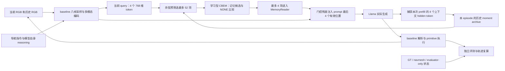

# HAMLET-Z V2 在 Case2 AwareVLN baseline 上的装配、训练来源与部署结论

> 最终状态（2026-11-01）：两数据集全量独立审计PASS；完整结果见第15节与result-show/Remaining-Full-final-analysis.md。前文“待测评/待审计”是历史阶段记录，不能替代本最终状态。

日期：2026-10-31（Asia/Singapore）。本结论在启动本次全量测评之前形成。

## 1. 当前结论与交付边界

Case2 已完成独立环境重建、历史版本定位、HAMLET 在现有 baseline 上的装配、CPU 回归和真实导航数据流验证。既有 `validate_engineering.py` 已正常通过，原验证条件没有删减。全量成绩将在新运行完整结束并经过独立审计后登记；本文件中的历史成绩与小规模诊断均不充当新全量成绩。

初始 baseline 已发布到 `woaijieyang/FirstPaper-VLN:HAMLET-baseline`，提交 `107317c86937b47c55b066e555bf4ac0129a1fd3`，commit message 为 `HAMLET-construct`，父提交为 case1 发布快照 `d230f31dbf38c8097594108665f6d0805530b44a`。本阶段后续装配源码尚在本地验证状态，最终发布须绑定全量运行及审计结果。

服务器写根为 `/data/zy/vln/case2`。case1、历史 case0 及全局原始数据和权重保持只读。本阶段复用已训练权重，执行部署、推理和测评；下面的训练章节说明历史模型的形成过程。

## 2. 版本怎样确定

目标是截图中的 `HAMLET-Z V2 / CBEM aw4 seed10`，原 run 为 `r2r_full1839_candidate_cbem_prefilter52_aw4_seed10_20260801_v1`。其 8 个原始分片重新聚合后得到 1839 个唯一 episode、零重复，SR 64.8722131593%、SPL 56.4369632726%、nDTW 66.1826261531%、NE 3.9913423347 m，与截图一致。这是历史数据重算。

同名产物也被复制到了 V3/V4，不能依目录名挑版本。原 `code_provenance.json` 给出了 288 个文件的 SHA：现存 V2 命中 287 个，唯一差异是 trainer。原 trainer 在 V2 的 `artifacts/eval_official_fallback_v1/awarevln_trainer.py.pre_official_fallback` 中找到，SHA 为 `3cde313f80f560aac4db5aa20d7fcc2639cab9f3a78fcbf9f50b85891a5e48a0`。至此 288/288 个原运行源码文件均可按 SHA 定位。

| 组件 | 冻结身份 |
|---|---|
| 官方 base 的历史规范身份 | `sha256:39ed5be154ff651af2cc5d8bb2813f22082c295e89331425af83a0320f3a88a6` |
| D3-v3 memory adapter 权重 | `26d631dbe14c8070c6e3eee11e77b36a3faaceb4ada7f6c7ebf6747374985b21` |
| abstention4_seed10 router 权重 | `76330dbb0548f3404ea738b6b61380798b46a64d276db35424b1e0ada01f7dd2` |
| router training manifest | `0f36a5ccc80758c4cc869040f0f92075d6144989cb03a80d9abe80ef95e60db4` |

Case2 重新计算的 16 个官方模型文件 SHA 全部与历史 base attestation 相同。版本定位、四个 checkpoint/config 文件验证和历史指标重算的机器证据位于 `.planning/2026-10-31-hamlet-construct/`；当前集成源码来源清单为 `configs/hamlet/source-provenance.json`。

## 3. 模型思路

AwareVLN 的 Llama、SigLIP 和原投影器继续处理指令及八帧视觉输入。HAMLET 在已有多模态 prompt 表示上加入由历史上下文构成的记忆，不把目标、GT 轨迹、测地距离或模拟器真值位姿作为模型输入。



**记忆内容与维度。** 每次生成从 LM head 前的完整 prompt prefill 捕获最后 4 个上下文 hidden token，形状为 `4×4096`；存储时转为 CPU FP16。query encoder 将当前 prompt 投影到 768 维，以 4 个可学习 query 读取当前多模态上下文。reader 使用 2 层、12 heads 的记忆编码及交叉注意力；年龄与记忆类型参与表示。

**检索与拒绝。** archive 容量固定 256，超出后按原 deque 规则淘汰最早项。先按余弦相似度预筛选最多 52 项，再由 rank=128 的学习型 CBEM 与显式 NONE 候选比较，最多选择 4 项。NONE 胜出时选择 mask 全假，reader 的有效读门为零，prompt 保持对应空记忆行为。

**注入。** reader 的输出已乘读概率，随后投影回 4096 维，只对最后 4 个有效 prompt 位置施加残差。当前 checkpoint 的 alpha 为约 `0.02618373`，运行时 `alpha_scale=0.5`；不能把配置中的 `alpha_init=0` 当成已训练权重当前值。`mode_lock=true` 时，仅在 prompt 确实发生记忆注入的条件下，用冻结 base 的 REASON/ACT 二选一结果约束首个生成 token，后续内容继续生成。

**写入规则。** 当前采用 `archive` condition，每次调用后的 moment 都进入 archive 和 recent；`write_threshold=0.8` 控制 event 分支，不是 archive 的入库门槛。生成前只能读取过去调用的 moment，本次 moment 必须在生成之后写入。连续 3 次模型转向决策触发原有的 2 次调用读记忆 fallback；fallback 关闭读注入，但仍采集本次 moment。episode 结束后清空记忆、调用序号、转向计数和 fallback 状态。

`aw4` 指 router 训练时的 **abstention loss weight=4.0**，与 `selected_top_k=4` 是两个独立参数。`seed10` 是该 router 的训练种子；当前 baseline 实际评测配置的 seed 保持 100，没有因版本名字改成 10。

## 4. 原逻辑保留与适配范围

| 项目 | 本次处理与验证 |
|---|---|
| memory adapter / state / CBEM 核心 | 按 SHA 复制 10 个推理依赖模块，另保留原部署验证器；未改变核心数学逻辑 |
| LLaVA 记忆方法 | 从原类提取 5 个推理方法到 `hamlet_v2/model.py`；逐方法 AST 与原版本一致，保留首 token mode-lock helper |
| baseline 模型 | 保留原 `forward`、模型加载、官方权重、视觉塔与投影器；通过 mixin 增加可选记忆方法 |
| trainer | 在原 generation 边界接入 HAMLET；保留八帧采样、原 prompt、原解析、primitive 执行及 TraceRecorder |
| prompt 与采样 | 有／无 reasoning、1／8 帧的四组 prompt 文本完全相同；采样函数 AST 与历史版本相同 |
| episode 边界 | 延续 baseline 已修复的动作队列、随机状态及 reasoning 清理，并显式清理 HAMLET 状态 |
| 原版解析器差异 | 截图 trainer 对未知动作／缺少幅度会抛错；当前 baseline 使用官方 forward、25 cm／15° fallback。此次保留 baseline 解析，不移植旧异常处理逻辑 |
| 模拟器与数据 | 使用已验证 baseline 的派生网格和端点修正协议，未重新选择参数或为提高分数调参 |
| checkpoint 路径 | 权重、config、training manifest 原字节保留；部署及完成证书只迁移绝对路径并更新对应引用 SHA，原证书另存 provenance；原 eligibility/completion 校验正常通过 |
| 非推理分支 | 历史 trainer 的训练采集、Oracle 分支、重复骨干和环境实现不进入本次活动推理链 |

因此，接下来测的是“正确历史 HAMLET 核心在当前 baseline 上的适配版本”。它不等同于运行整个旧评测器，历史 64.872% 也不是本次必须达到或人为调参追逐的目标。

## 5. 训练方法与已恢复的历史证据

### 5.1 Memory adapter 的形成

训练时冻结 AwareVLN backbone，更新 memory 模块；本阶段不再训练这些权重。原状态文件给出的链条为：

| 阶段 | 真实记录 | 训练范围与目标 |
|---|---|---|
| T1_WEAK_SFT | 4326 optimizer steps；8 ranks；micro batch 2，global batch 16 | `all_memory`，32,386,563 个参数；包含 token/read/write 及 preservation 的组合；状态显式记录的 token/write/preservation 权重为 1.0 / 0.2 / 0.1；alpha 从 0 到约 0.02706143 |
| T1_5_INTERVENTION_BOOTSTRAP | 31 steps；1 rank；31 source reference pairs | 同一 memory 模块，action-token preference；beta=1，margin=1，reference 系数 10、event-isolation 系数 1；alpha 到约 0.02663982 |
| T2_BRANCH_STRONG | 15 steps；8 ranks；15 source reference pairs | train-only 同状态分支的强偏好；action-token preference，beta=1，margin=0，reference 系数 10；alpha 到约 0.02618373 |
| T2_WRITE_STRONG → D3-v3 | 12 steps；1 rank；batch 1 | 仅 write gate，295,681 个参数；lambda_write=1、token/preserve 系数为 0；alpha 保持约 0.02618373 |

SFT 源码使用冻结模型的 token supervision 与 preservation 分支；偏好阶段对 chosen/rejected 的 action-token 分数施加排序约束，并保留 reference KL／CE-drift 约束。这里只说明原实现和状态文件支持的训练过程，不把这些训练 loss 当作在线导航能力证明。

T1/T1.5/T2 的实际学习率与完整原启动命令没有在本次全部恢复。源码默认值不等于历史实用值，故不将缺失字段补成已知超参数。若之后要求从头训练，应先恢复完整命令、数据清单和历史依赖，再单独执行训练验收。本阶段训练源文件和状态快照已保存于 `outputs/provenance/hamlet-training-history/`，其中 `manifest.json` 记录来源及 SHA。

### 5.2 CBEM router 的训练

router 单独在冻结特征缓存上训练，`run_start.json` 明确记录 `backbone_loaded=false`、`memory_adapter_loaded=false`、`reference_parameters_trained=false`，训练参数量为 233,730。其监督来自 Habitat simulator / reference-path scalar reward 的 train-only 同状态反事实分支；训练标签和 target-preservation 信息不在部署选择时访问。

本次按 pair 数据 SHA 及 `(scene, episode_id)` 重新核验：训练缓存 21 pairs / 6 episodes，开发缓存 17 pairs / 3 episodes；均属于官方 R2R train，和 val_unseen 的完整身份交集为 0；训练／开发的 episode、scene 交集也为 0。这是小规模 off-policy pilot，不是大规模训练。

确定的 router 超参数：AdamW、learning rate `3e-4`、weight decay `0.01`、batch size 32、100 epochs、gradient clip 1.0、seed 10。选中的是 best epoch 25，选择顺序包含 gate pass、pair accuracy、诚实的 helpful-target coarse recall、harmful/helpful recall 和最早 epoch。不是按本次全量 SR 选模型。

代码目标为：

`L = 1.0 L_pair + 4.0 L_abstention + 0.25 L_use + 1.0 L_target`

pair / abstention / target margin 均为 0.1，集合 utility 使用 `masked_max`。NONE 项使有害或无用记忆可以被拒绝；训练期 target 信息用于方向监督，开发／部署仍须按不访问 target 的检索规则执行。原离线 gate 为 PASS，但原文件也明确限制该 gate 只能说明精确 pilot 上的 router 行为，不能直接证明 SR/SPL/nDTW 提升。

## 6. Case2 的组织与搭建

```text
src/hamlet_v2/                  baseline 适配、原方法 mixin、策略身份绑定
src/awarevln_memory/            历史推理核心与部署验证器
src/llava/                     baseline 模型 + 可选记忆方法
src/vlnce_baselines/            原导航循环 + generation/reset 接口
configs/hamlet/                aw4-seed10 冻结参数及来源清单
scripts/                       环境、数据、评测和独立审计入口
tests/hamlet/                  历史核心回归与数据流反例
runtime/awarevln/               独立 Python / Torch / Habitat 环境
models/hamlet-v2/               独立 adapter/router 与可校验迁移证书
data/                          只读共享数据链接及本地派生网格
outputs/                       原始运行、图像、轨迹、数据流与审计证据
results-show/                  机器登记的模型结果和分开的部署诊断
```

环境按发布快照中的 conda、pip 和 native source 锁重建，未激活或借用 case1 Python。Python 3.10、Torch 2.3.0、Transformers 4.37.2、Habitat-Lab/Sim 0.1.7 的实际导入都在 case2。Habitat 原生组件重新编译；原生源码只包含已声明的 pybind11 `cstdint` 和 NumPy `np.float` 兼容修正。

安装时 GitHub wheel 下载缓慢，前两次安装尝试及中断记录保留。随后使用独立复制的分发包缓存；FlashAttention wheel 的 SHA 与原 URL 锁完全相同，只有传输位置改变。`pip check`、native linkage、真实渲染和网格 hash 验证通过。`scripts/freeze_dependencies.py` 只有在本地 wheel 位于本 case 缓存且 SHA 精确等于原锁时才恢复其可移植来源，未放松版本约束。

标准搭建与核验入口如下；在新空目录按依赖锁安装，不应对正在运行的冻结环境重执行安装：

```bash
cd /data/zy/vln/case2
bash scripts/setup_environment.sh
python3 -B scripts/setup_data_links.py
scripts/with_runtime.sh --prepare-configs runtime/awarevln/bin/python -B scripts/build_derived_annotations.py
scripts/with_runtime.sh --prepare-configs runtime/awarevln/bin/python -B scripts/freeze_environment.py
scripts/with_runtime.sh runtime/awarevln/bin/python -B scripts/preflight.py
scripts/with_runtime.sh runtime/awarevln/bin/python -B scripts/check_native_dataset.py
scripts/with_runtime.sh runtime/awarevln/bin/python -B scripts/freeze_model.py
```

模型与数据资产不进入 Git。官方 base 通过只读共享视图接入；HAMLET adapter/router 为 case2 自有副本。启动器将写入限制在本 case 的缓存、运行输出和明确管理目录。`case1_runtime` 包名及 `CASE1_*` 变量是继承的内部命名，实际 ROOT、解释器、模块和缓存路径均经核验为 case2。

## 7. 数据流怎样被实际核验

每次调用先保存 baseline 的 token IDs、8 帧图像引用和处理后图像张量 hash。HAMLET 另存相同输入的 hash、历史 item ID、年龄／mask 与 moment hash；拒绝当前或未来调用的 moment。路由记录候选集合、NONE 决策和选中项，验证候选索引与 mask 对齐。

Adapter hook 保存 base/adapted prompt 的 hash 与最大差值；实际 LLM forward pre-hook 检查生成 prefill 的形状、dtype、内容与 adapted prompt 一致。新 moment 在生成后写入，下一调用读到的存储 hash 必须对应此前写入。输出 token hash 与 baseline trace 对齐，解析后的动作反馈与实际 primitive 轨迹关联，episode 终止后清理全部记忆状态。

`audit_hamlet_flow.py` 独立合并这些事件；正式结果准入还要求 HAMLET 数据流审计 PASS、完整 episode 覆盖、确实存在非零选中记忆消费，且审计绑定的 trace 文件没有变化。普通导航失败保留在分母；成功导入、选中了记忆、CPU 测试通过都不能替代这一步。

## 8. 已完成的测试

| 检查 | 结果与可说明范围 |
|---|---|
| 环境与资产 | 6 项链接、3 种真实内核写保护模式、pip check、模块路径、native linkage、官方模型 Git/LFS 身份均通过 |
| CPU | 41 baseline unittest + 30 HAMLET pytest = 71，通过且零失败／错误／跳过 |
| 打包 | 真实 wheel 构建成功；17 个集成关键源文件与 wheel 成员逐字节一致；5 个关键类实际来源位于 case2/src |
| 全量静态数据 | R2R 1839 + RxR-US 1223 = 3062，距离均有限；GT 参考轨迹仍有 101 条涉及离网点的既有局限 |
| 模拟器 | 48 条运动诊断及独立原生回放 PASS，最大位置误差 0；这是模拟器诊断 |
| 初始 baseline 真模型 | R2R 2 + RxR 11 完整 episodes；369 模型调用、811 primitive 动作；输入／动作及独立指标复算通过 |
| HAMLET 真模型 | R2R 2 + RxR 35 完整 episodes；1108 模型调用、2429 primitive 动作；125 次非零选中记忆消费；独立数据流与指标复算通过 |
| HAMLET-off 回归 | 同 GPU 上 2 条 R2R 的 78 次模型调用、146 个动作，以及图像/prompt/token/轨迹/指标与装配前 baseline 一致 |
| episode 顺序 | 同 GPU 上 B 单独运行与接在 A 之后运行一致；原顺序审计 PASS |
| 工程正式门槛 | 原 `validate_engineering.py` 按完整参数执行通过；含 33 条原非有限场景覆盖、48 条 motion/replay、35 条 RxR pilot、真实 order 和独立环境证据 |

R2R pilot 仅 1/78 次调用出现非零选中记忆消费，RxR pilot 为 124/1030；这说明真实使用情况受场景和路由控制，不能据此推广为全量使用率或收益。详细原始证据位于 `outputs/case2-hamlet-pilot-{r2r,rxr}-v1/`、`outputs/verification/hamlet-off-baseline-equivalence.json`、`outputs/verification/hamlet-order.json` 与 `outputs/gates/engineering.json`。

测试曾暴露 reset-slice 单元夹具没有提供新增 HAMLET 上下文；修正夹具并增加真实 reset 调用断言，原有 baseline 清理断言全部保留。正式全量结果校验器拒绝 diagnostic scope 的日志也保留，未把诊断改名成全量成绩。

## 9. 全量测评协议与接续

采用当前 baseline 的完整 R2R val_unseen 1839 条及 RxR-US val_unseen 1223 条。R2R 与 RxR-US 并行执行，各保留原有 8 个逻辑分片。为避免两个控制器抢同一空闲卡，R2R 固定允许 0/2/3/4，RxR 固定允许 1/5/6/7；两组互斥且合计覆盖 0–7。现有调度器只使用实时空闲卡。当前 0/1 有外部进程，当前可立即使用的是 2–7；不终止外部进程。逻辑 CPU 上限保持已验证的 64，不为调度改变模型或数据协议。

冻结 `--method hamlet`、原 checkpoint、archive/mode-lock/fallback 参数、500 primitive step 上限、256 生成 token 上限、0.25 m 前进和 15° 转角。保持原 episode 清单，不选择性重跑普通导航失败，不热改活动源码、环境或运行配置。

```bash
scripts/with_runtime.sh runtime/awarevln/bin/python -B scripts/evaluate.py \
  --method hamlet --dataset r2r --gpu-ids 0,1,2,3,4,5,6,7 \
  --run-id case2-hamlet-full-r2r-20261031-v1 \
  --profile data/derived/navmeshes/awarevln-scene-minimal-endpoint9-v2/profile.json --scope full
```

RxR 使用相同入口和冻结协议，`--dataset rxr`、run ID `case2-hamlet-full-rxr-20261031-v1`。每个 run 完整结束后依次执行 `audit_model_trace.py`、`recompute_metrics.py`、`audit_hamlet_flow.py`、`validate_results.py`；通过后才登记正式结果并更新本结论。

完整套件启动入口为 `python3 -B tools/run_hamlet_full_suite.py`。它拒绝已有 run identity，分别归档两个 run，审计通过后才串行登记并生成结果表。主状态位于 `outputs/hamlet-full-suite-20261031-v1/state.json`，单数据集状态为同目录 `state-r2r.json` / `state-rxr.json`。

每 1 小时检查一次控制器和 worker 身份、进度、错误、GPU 与关键冻结身份。健康运行保持原样；完成或异常时处理相应审计或保留失败。检查绑定本次 run，不重启相同 identity、不修改参数追求正结果。两个全量 run 和后处理全部闭合后移除闹钟。

当前研究限制包括：历史 router 训练是小样本 off-policy pilot；部分早期 adapter 训练参数未完整恢复；当前 baseline 有已公开的网格/GT 几何局限；新版本含明确的解析与 episode-reset 适配。全量结束前，不报告本次 SR/SPL/nDTW/NE 或宣称相对 baseline 改进。

## 10. 用户最终资源与分阶段协议修订（2026-10-31）

最新授权覆盖第9节的旧调度计划：只能使用 GPU4–7 的全部可用显存，CPU 使用末尾72个逻辑CPU，即24–95。旧 `hamlet-full-suite-20261031-v1` 已按此要求停止并保留 partial 记录，不能并入新协议。仅将 runtime/build launcher 的 CPU affinity 从前64改为末72；与此前已验收源码逐文件比较，除此两行外的模型、记忆、prompt、parser、数据和指标代码均未变。新41项CPU回归及三种内核保护检查通过，原工程门槛与真实记忆消费证据作为明确绑定的前序证据保留。

新 run 为 `case2-hamlet-abc-20261031-v2-r2r` 和 `case2-hamlet-abc-20261031-v2-rxr`。控制器 `tools/hamlet_abc.py` 在保护环境中统一调度，两数据集共同经过 A→B→Remaining；A 完整审计后才开始 B，B 完整审计后才开始 Remaining。GPU4/5/6/7 对应 CPU24–41/42–59/60–77/78–95，每 worker 18个逻辑CPU，四个 worker 的并集为72。去除旧24GiB共享分配限制，不改模型精度或生成预算。

14个原生叶子数据读取检查全部通过；R2R A/B/Remaining 分别612/612/615，RxR-US分别407/407/409。Remaining 仅在分片调度层拆成4份覆盖，成员互斥且与原清单并集一致。启动配置 NUM_CHUNKS=1，每个 worker 显式绑定本 run 的 dataset-spec 与 IDs；源模型、数据文件、逐场景网格内容和完整task集合均已核验。

用户指定的本阶段结果目录为 `result-show`（单数）。`result-show/model_results.md` 与 JSON 由 `tools/report_hamlet_abc.py` 生成，保留 A1–A3/B1–B3、A/B/Remaining/A+B/Full；每项同时列新HAMLET、已发布baseline、历史原HAMLET及差值。baseline和旧HAMLET按逐episode原始记录重算，不平均块均值。没有旧候选RxR结果时明确缺失，跨旧协议差值只作描述性比较。

每小时检查闹钟已创建，ID `case2-hamlet`。健康运行保持不动，完成或异常才处理。源冻结为 `ed8461301ce972ba9684e49fe199cf9b8295529859c0582a8b2d5d49c61b118a`。当前入口：`outputs/hamlet-abc-20261031-v2/state.json`；分阶段快照保留，不把部分运行填成正式分数。

## 11. A阶段完成与结果（2026-11-01 07:19核验）

R2R612、RxR-US407全部通过阶段审计，已进入B。R2R SR64.2157%（baseline65.1961%，下降0.9804pp），RxR SR63.8821%（baseline65.1106%，下降1.2285pp）。R2R相对原历史HAMLET SR61.7647%高2.4510pp，但跨旧协议差值只能描述，不能简单归因。实际记忆消费R2R8587次、RxR10366次，不等于性能收益。完整对照和配对恢复/退化分析见result-show/A-stage-analysis-20261101.md及model_results.md。模型和参数保持冻结，不因负结果重跑。

## 12. B阶段完成与Remaining执行中

B阶段已审计：R2R SR66.6667% vs baseline66.9935%（-0.3268pp），RxR-US68.7961% vs67.5676%（+1.2285pp）。A+B合计R2R65.4412% vs66.0948%（-0.6536pp），RxR-US双方66.3391%。RxR的B阶段恢复抵消A的退化，但累计SPL/nDTW/NE尚未优于baseline。详见result-show/B-stage-analysis-20261101.md。Remaining仍运行，R2R执行完不代表Full审计已完成；不提前报告Full结果。

## 13. R2R独立全量审计与发布等待状态（2026-11-01）

R2R独立快照四项全量审计均已通过并重新核对回执哈希。Remaining615条：HAMLET SR64.5528%、baseline64.7154%、原历史HAMLET64.5528%；Full1839条：HAMLET65.1441%、baseline65.6335%、原历史HAMLET64.8722%。Full相对baseline净少9个成功（恢复64、退化73），SR−0.4894pp；相对原历史HAMLET多5个成功，SR+0.2719pp，旧协议差异保留。完整五指标与差异见result-show/R2R-remaining-full-independent.md、R2R-remaining-full-analysis.md。

RxR1223条推理已齐全，但当前套件尚在最终独立审计，不能将推理完成等同审计完成。用户已要求删除每小时闹钟，case2-hamlet自动化已实际删除。只有两组最终审计通过、结果与发布树核验完成后，才进行最终HAMLET-baseline推送；此前baseline提交107317c保持不变。

## 14. 方法归属与数据准备更正

当前方法为历史HAMLET-Z V2+CBEM导航改造，并非原论文HAMLET的等价复现。CBEM为本地Counterfactual Benefit-guided Episode Memory路由；learned moment token/TCL/原动作条件接口与本地截取hidden state、archive检索和prompt残差机制存在实质差异。详细原文对照见result-show/HAMLET原文对照与训练数据扩充分析-20261101.md，不能把当前模型的正负结果解释为原论文方法本身的优劣。

用户指定后续训练数据范围为R2R、RxR和Landmark-RxR。已完成data/landmark干净索引（20847条，train默认15899条，另209条修正映射训练候选）和data/baseline-rollouts历史轨迹清单，详见各自README/manifest/validation。原大资产保持只读，这些本地数据索引不随代码Git发布；不等同已启动新训练。

## 15. 最终全量审计与科学结论（2026-11-01）

R2R1839/1839与RxR-US1223/1223全部完成，独立全量审计通过；输入图像/token、输出解析与primitive执行、记忆实际消费、独立轨迹指标、完整分母/有限值及冻结身份均核验。独立快照与原运行manifest/results/effective-configs逐字节一致。RxR按原有互斥分片并行使用同一份输入/动作审计脚本，验证1223条任务并集后执行原指标/记忆/全量准入脚本，未降低门槛。

| 数据集 | 范围 | 新SR% | baseline SR% | 原HAMLET SR% | 新SPL% | 新nDTW% | 新NE m |
|---|---|---:|---:|---:|---:|---:|---:|
| r2r | Remaining | 64.552846 | 64.715447 | 64.552846 | 56.448756 | 65.841264 | 3.987430 |
| r2r | Full | 65.144100 | 65.633496 | 64.872213 | 56.624835 | 65.272908 | 3.972517 |
| rxr | Remaining | 69.682152 | 70.171149 | 无可核验旧记录 | 58.570186 | 69.080507 | 3.895416 |
| rxr | Full | 67.457073 | 67.620605 | 无可核验旧记录 | 55.881547 | 67.240320 | 4.346312 |

R2R Full恢复64条、退化73条，净少9个成功；RxR Full恢复56条、退化58条，净少2个成功。R2R Remaining净少1条；RxR Remaining净少2条，使其A+B成功率持平最终变成Full略低。RxR Remaining的SPL/nDTW/NE优于baseline而SR略低，不能概括为所有方面改善或退化；Full的SPL/nDTW略低、NE略高。尚未做显著性检验，不把小幅差值写成已证实的统计显著结论。

完整表及配对分析：result-show/model_results.md、Remaining-Full-final-analysis.md/json。原历史HAMLET仅R2R有对应完整证据，RxR不编造旧对照。原模型/网格/训练局限均保留。工程验收通过不等于科学性能提升，当前两组Full均没有显示相对baseline的SR提升。

两个独立完整审计通过后，原重复串行审核和报告包装进程已封存并停止，见outputs/hamlet-abc-20261031-v2/serial-audit-superseded.json；停止时没有模型worker。未修改模型、审计脚本或验收阈值，没有重新导航。当前审计依据为outputs/publication/full-audits-verified.json列出的原始结果及独立回执。闹钟已按用户要求删除。最终发布为本次历史改造版的真实结果，不代表原论文完整复现。

登记摘要一致性修正：最初由系统Python3.12生成的aggregate与评测Python3.10的sum末位存在不超过1e-15的差异，原严格登记器拒绝Stale summary。保留旧摘要后使用原评测解释器重生成，未修改逐episode结果、公式或容差。证据outputs/publication/summary-runtime-normalization.json。
